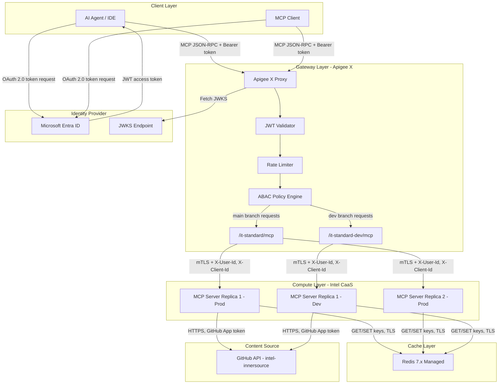
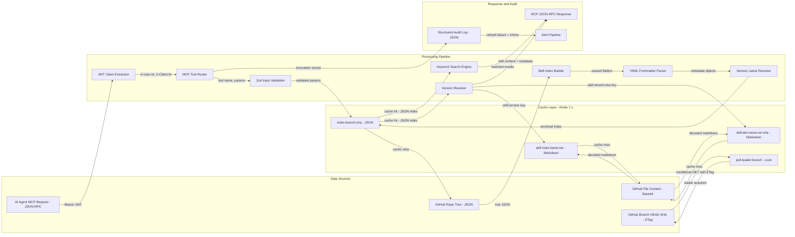
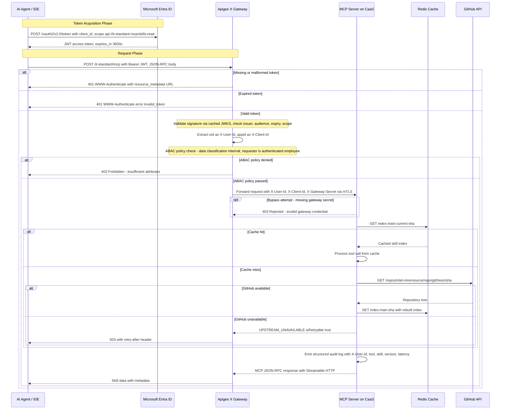
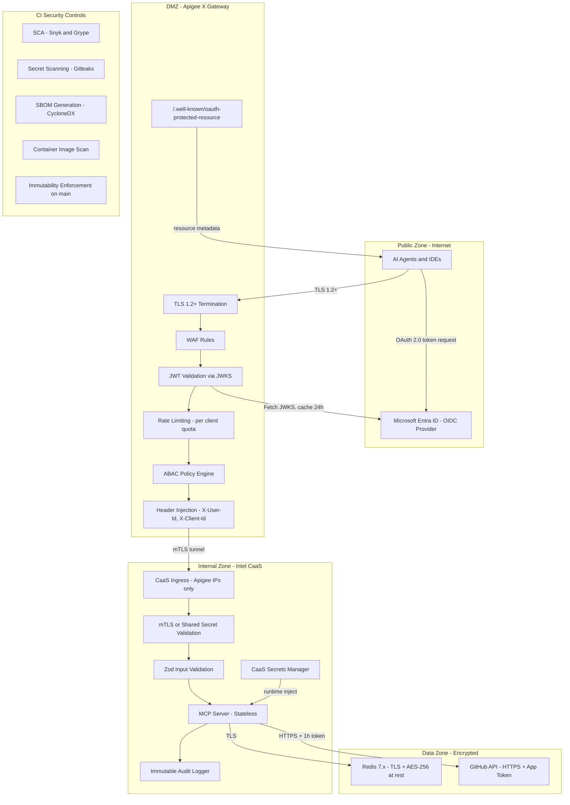
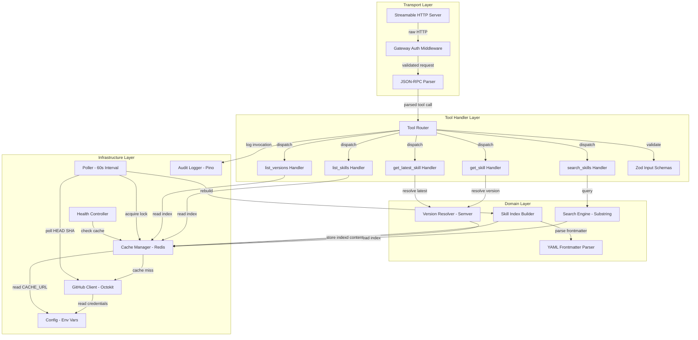
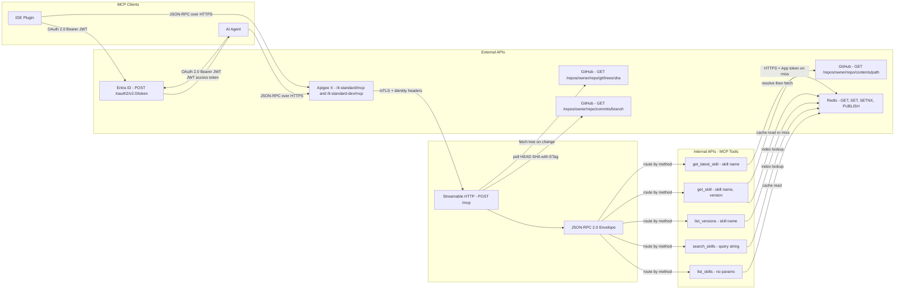
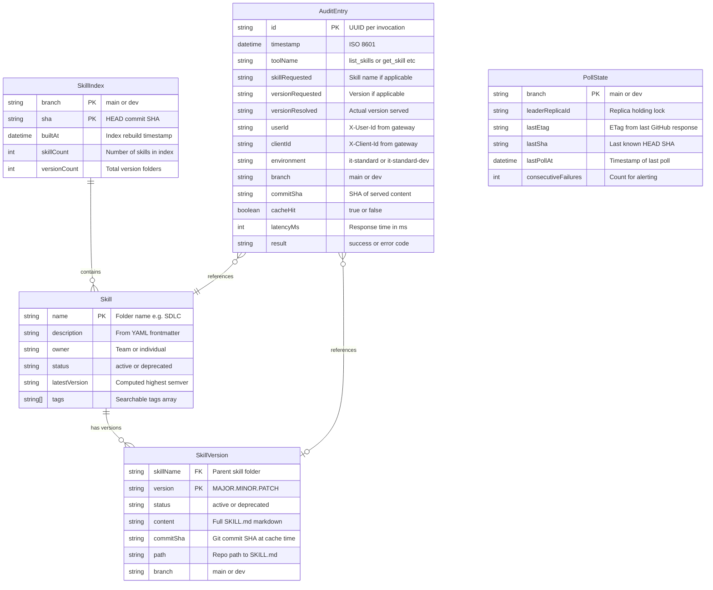
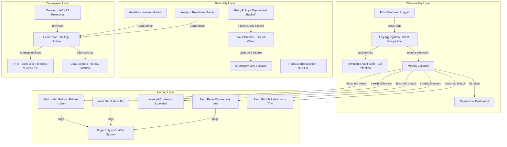

# ARCHITECTURE OPTIONS

**Project:** SDLC-AI  
**Generated:** 2026-11-18T22:19:31.106Z

---

## Architecture Executive Summary

### Project Context

The IT-Standard MCP server is a greenfield, read-only Model Context Protocol service designed for Intel's enterprise AI ecosystem. It provides any MCP-compatible AI agent or IDE with instant, versioned access to a curated catalog of agent SKILLs stored in a GitHub monorepo (`intel-innersource`). The system exposes five purpose-built tools — `list_skills`, `search_skills`, `list_versions`, `get_skill`, and `get_latest_skill` — all secured behind OAuth 2.0 authentication enforced at an Apigee X API gateway with Microsoft Entra ID as the identity provider.

The primary personas are **MCP Client / AI Agent** (autonomous consumers of skill content), **Skill Contributors** (developers authoring SKILL.md files), **Admin / Skill Publishers** (CODEOWNERS-listed reviewers), and **Platform / DevOps Engineers** (operators of the infrastructure). The system targets ≥40% adoption of eligible AI agents within 90 days of GA, with a 99.5% monthly uptime SLO and p95 response latency ≤200 ms for cache-hit requests.

### Architectural Philosophy

1. **Read-Only Immutability** — The MCP server performs zero write operations. GitHub is the single source of truth; the server materializes a read-only cache. This dramatically simplifies the security model, eliminates write-path failure modes, and enables aggressive caching of immutable production content.

2. **Gateway-Enforced Security** — All authentication, JWT validation, rate limiting, and routing happen at Apigee X. The MCP server itself is a "dumb" backend that trusts gateway-forwarded identity headers. This separation of concerns reduces the server's attack surface and centralizes security policy management.

3. **Stateless Compute, Shared State** — The MCP server maintains no session state. All shared state (skill index, content cache) lives in Redis. This enables horizontal scaling on Intel CaaS with zero code changes and simplifies container orchestration.

4. **Graceful Degradation** — The system serves stale-but-last-known-good content from cache during GitHub outages. Only items never previously cached return UPSTREAM_UNAVAILABLE. This ensures agents continue operating even when upstream dependencies are partially unavailable.

5. **Full Observability with Immutable Audit Trail** — Every tool invocation is logged with actor identity, skill/version accessed, cache hit/miss, latency, and commit SHA. These logs serve dual purposes: operational debugging and SOC 2/GDPR compliance evidence.

### Intent Alignment

Each major architectural choice traces directly to a project goal:
- **Materialized cache from GitHub polling** → enables ≤60s content freshness (Business Objective: single source of truth)
- **Apigee X gateway with Entra ID** → enforces OAuth 2.0 without server-side token handling (Core Feature: OAuth 2.0 Authentication)
- **Dual environment deployment** → enables pre-production testing on dev branch (Core Feature: Dual Environment Deployment)
- **Forge Shipping pipeline** → automates CI/CD with security scanning (Decision Anchor: Forge Shipping)
- **Redis shared cache** → supports horizontal scaling and cross-replica consistency (Technical Constraint: stateless design)

### Architecture Decision Records

| Decision | Choice | Alternatives Considered | Rationale | Trade-offs |
|----------|--------|------------------------|-----------|------------|
| Runtime Language | TypeScript with Node.js 20+ and `@modelcontextprotocol/sdk` | (1) Python with FastMCP — mature async, Pydantic validation, but weaker MCP SDK maturity for Streamable HTTP; (2) Go — excellent performance but no official MCP SDK | TypeScript SDK v2 has first-class Streamable HTTP transport support, Zod-based input validation, and the largest MCP ecosystem. Node.js 20+ provides native fetch and stable async primitives. | Requires Node.js runtime expertise; slightly higher memory footprint than Go; Zod schemas must be maintained alongside tool definitions |
| API Gateway | Apigee X (mandated) | (1) Kong Gateway — open-source, flexible plugins; (2) AWS API Gateway — managed but wrong cloud; (3) No gateway, validate JWTs in-server | Apigee X is Intel's enterprise standard, provides JWT validation, rate limiting, streaming support, and dual-path routing. Mandated by technical constraints. | Vendor lock-in to Google Cloud Apigee; requires Apigee Platform Team coordination; streaming timeout configuration is non-trivial |
| Cache Layer | Redis 7.x (managed on CaaS) | (1) Memcached — simpler but no data structures; (2) In-process LRU cache — no cross-replica sharing; (3) SQLite — persistent but not designed for shared cache | Redis provides key-value storage with TTL, pub/sub for future use, and is available on CaaS. Cross-replica cache sharing eliminates redundant GitHub API calls. | Adds an infrastructure dependency; requires Redis availability monitoring; network latency adds ~1-2ms per cache operation |
| Content Source Access | GitHub App with read-only contents permission | (1) Fine-grained PAT — simpler setup but tied to a user account; (2) OAuth App — broader permissions than needed; (3) Deploy key — repo-scoped but no API tree access | GitHub App provides installation-scoped tokens with automatic rotation, higher rate limits (5,000 req/hr vs 5,000 for PAT), and is not tied to a human account. | Requires GitHub App registration and private key management; installation token refresh adds complexity |
| Change Detection | Poll branch HEAD SHA every 60s with ETag | (1) GitHub webhooks — near-instant but requires public endpoint and HMAC validation; (2) GitHub Actions workflow dispatch — event-driven but adds CI dependency; (3) Longer polling interval (5 min) — fewer API calls but stale content | Polling with ETag is explicitly mandated. 304 responses do not count against rate limits. No webhook endpoint simplifies network security (CaaS ingress stays private). | Up to 60s latency for new content; one API call per interval per replica (mitigated by shared cache leader election) |
| Authorization Model | Attribute/policy-based authorization at gateway + universal read access | (1) RBAC with per-group skill restrictions — complex, not required; (2) No authorization beyond authentication — simpler but does not satisfy decision anchor; (3) OPA sidecar — powerful but operationally heavy | Decision anchor mandates ABAC. Initial implementation enforces data classification (all skills = Internal) and requester attributes (authenticated Intel employee). Gateway applies policy. Extensible for future per-group restrictions. | Adds Apigee policy complexity; initial implementation is effectively universal read but with ABAC framework in place |
| Deployment Platform | Intel CaaS (mandated) with dual environment config | (1) Kubernetes on public cloud — more flexible but not Intel standard; (2) Serverless (Lambda/Cloud Functions) — cold start issues with MCP streaming | CaaS is mandated. Same container image with environment-variable differentiation (GITHUB_BRANCH, CACHE_URL) enables consistent deployments. | Dependent on CaaS platform capabilities; limited visibility into underlying orchestrator |
| CI/CD Pipeline | Forge Shipping Engine | (1) GitHub Actions — native to GitHub but not Intel standard; (2) Jenkins — legacy, high maintenance; (3) GitLab CI — not in use at Intel | Decision anchor mandates Forge Shipping. Provides built-in step catalog for build, scan, push, deploy, test, and gate steps with 40+ integrations. | Team must learn Forge Shipping conventions; pipeline-as-code must be maintained alongside application code |
| Observability | Structured JSON logs + immutable audit trail | (1) OpenTelemetry traces only — rich but complex; (2) Metrics-only (Prometheus) — no audit trail; (3) Third-party APM (Datadog, New Relic) — cost and data residency concerns | Full observability with immutable audit trail is a decision anchor. Structured JSON logs are SIEM-compatible, support SOC 2 evidence collection, and enable adoption tracking via X-Client-Id analysis. | Log volume at 500 req/min ≈ 720K entries/day; requires log rotation and retention management; PII masking adds processing overhead |

---

## System Architecture Overview

### Multi-Layer Architecture

The IT-Standard MCP server follows a layered architecture with clear separation between the public-facing gateway, the stateless compute tier, the shared cache layer, and the external content source. Each layer has a well-defined responsibility and failure domain.

### Layer Responsibilities

| Layer | Components | Responsibility | Failure Domain |
|-------|-----------|---------------|----------------|
| Client | AI Agents, IDEs, MCP Clients | Obtain OAuth tokens from Entra ID, send MCP tool calls | Client-side; no impact on server |
| Gateway | Apigee X, Entra ID JWKS | JWT validation, rate limiting, header injection, streaming proxy, ABAC policy enforcement | Gateway outage = total service unavailability |
| Compute | MCP Server (Node.js/TypeScript) on CaaS | Tool handling, index building, version resolution, search, structured logging | Stateless; individual replica failure has no impact if ≥2 replicas |
| Cache | Redis 7.x (managed) | Shared skill index, content cache, polling coordination | Cache miss degrades to GitHub fetch; total Redis failure degrades to per-replica in-memory fallback |
| Content Source | GitHub API (intel-innersource) | Authoritative skill content, repo tree, branch HEAD SHA | Outage triggers graceful degradation (serve from cache) |

### Network Topology

- **Apigee X** is the only public-facing endpoint. CaaS ingress is restricted to Apigee egress IP addresses.
- **Apigee-to-MCP** communication uses mTLS or a shared secret header (`X-Gateway-Secret`) to reject bypass attempts.
- **MCP-to-Redis** uses private CaaS networking with TLS encryption in transit.
- **MCP-to-GitHub** uses HTTPS with GitHub App installation tokens (auto-rotated, 1-hour TTL).

### Horizontal Scaling Strategy

The MCP server is fully stateless. All replicas share the Redis cache. To avoid redundant GitHub polling across N replicas, a **polling leader election** pattern is used:
- One replica acquires a Redis lock (`poll-leader:<branch>`, TTL 90s) and performs the 60-second HEAD SHA poll.
- Other replicas read from the shared cache.
- If the leader fails, another replica acquires the lock within one polling interval.
- Target: 3 replicas in production, 2 in dev. Auto-scale to 6 replicas at 70% CPU utilization.

### Blast Radius Analysis

| Failure | Blast Radius | Mitigation |
|---------|-------------|------------|
| Single MCP replica crash | None — CaaS routes to healthy replicas | Min 2 replicas; health checks at /healthz |
| Redis unavailable | Degraded — cache misses increase GitHub API load | In-memory fallback cache (LRU, 5-min TTL); alert on Redis connectivity |
| GitHub API outage | Degraded — stale cache served; uncached items return UPSTREAM_UNAVAILABLE | Indefinite cache for main branch content; alert after 10 min |
| Apigee X outage | Total — no requests reach MCP server | Apigee SLA; no mitigation at MCP layer |
| Entra ID outage | Total — no new tokens issued; existing tokens work until expiry | Token TTL provides grace period; Apigee caches JWKS |



---

## Data Flow Diagram

### End-to-End Data Pipeline

The IT-Standard MCP server has two primary data flows: the **request path** (agent → Apigee → MCP → cache/GitHub → response) and the **background refresh path** (polling timer → GitHub → index rebuild → cache update). Both flows converge at the Redis cache layer.

### Request Path Data Flow

1. **Agent sends MCP JSON-RPC request** with Bearer JWT to Apigee X.
2. **Apigee validates JWT** (signature via JWKS, issuer, audience `api://it-standard-mcp`, expiry, scope `skills.read`), extracts claims, and injects `X-User-Id` and `X-Client-Id` headers.
3. **Apigee routes** based on path prefix: `/it-standard/mcp` → production replicas, `/it-standard-dev/mcp` → dev replicas.
4. **MCP server parses JSON-RPC** envelope, identifies the tool (`list_skills`, `get_skill`, etc.), validates input parameters (Zod schemas).
5. **Cache lookup** in Redis using structured keys:
   - Index: `index:<branch>:<sha>`
   - Content (main): `skill:main:<skill>:<version>` (no TTL — immutable)
   - Content (dev): `skill:dev:<skill>:<version>:<sha>` (invalidated on SHA change)
6. **On cache miss**, fetch from GitHub API: repo tree for index, file content for individual skills.
7. **Populate cache** with fetched content.
8. **Return MCP JSON-RPC response** with skill metadata (name, version, status, branch, commit_sha, path, content, warnings).

### Background Refresh Data Flow

1. **Polling leader** (elected via Redis lock) sends conditional GET to GitHub API for branch HEAD SHA with ETag.
2. **304 Not Modified** → no action, no rate-limit consumption.
3. **New SHA** → fetch full repo tree at new SHA, parse skill folders, extract YAML frontmatter from each SKILL.md.
4. **Compute latest version** per skill using numeric semver comparison (e.g., 1.10.0 > 1.9.0).
5. **Update Redis** with new index key `index:<branch>:<new-sha>`, invalidate dev content keys with old SHA.
6. **Publish cache-updated event** (Redis pub/sub) so non-leader replicas refresh their in-memory references.

### Data Formats

| Data Element | Format | Size Estimate | Storage |
|-------------|--------|--------------|----------|
| Skill index (500 skills) | JSON array of metadata objects | ~250 KB | Redis key, refreshed per SHA |
| Individual SKILL.md | Markdown with YAML frontmatter | 2-20 KB per file | Redis key, immutable on main |
| Repo tree (10,000 entries) | GitHub Tree API JSON | ~1.5 MB | Transient, parsed into index |
| Audit log entry | Structured JSON | ~500 bytes per entry | Log aggregation system |

### Storage Estimates

- **Redis memory**: 500 skills × 20 versions × 10 KB avg = ~100 MB for content + ~250 KB for index ≈ **~110 MB total**
- **Log volume**: 500 req/min × 500 bytes × 1440 min/day ≈ **~360 MB/day** (before compression)
- **Audit log retention**: 360 MB/day × 365 days ≈ **~130 GB/year** (compressed ~30 GB with gzip)



---

## Authentication & Authorization Flow

### Authentication Architecture

The authentication flow follows a strict gateway-enforced pattern where the MCP server never handles raw JWT tokens. This design minimizes the server's security surface and centralizes token management at Apigee X.

### Flow Details

1. **Token Acquisition**: The AI agent's host application obtains an OAuth 2.0 access token from Microsoft Entra ID using a pre-registered app registration with scope `api://it-standard-mcp/skills.read`. Tokens are issued with a configurable TTL (default 1 hour for Entra ID).

2. **Gateway Validation**: Apigee X validates the JWT against Entra ID's JWKS endpoint, checking:
   - Signature validity (RS256)
   - Issuer: `https://login.microsoftonline.com/{tenant-id}/v2.0`
   - Audience: `api://it-standard-mcp`
   - Expiry: token not expired
   - Scope: `skills.read` present
   - Apigee caches the JWKS with a 24-hour TTL to avoid repeated fetches.

3. **ABAC Policy Enforcement**: Per the decision anchor, Apigee applies attribute/policy-based authorization. Initial implementation checks:
   - Data classification of requested resource (all skills = Internal)
   - Requester attribute: authenticated Intel employee (verified by valid Entra ID token)
   - This framework is extensible for future per-group restrictions without MCP server changes.

4. **Header Injection**: Apigee extracts `oid` (object ID) and `appid` (application ID) claims from the JWT and forwards them as `X-User-Id` and `X-Client-Id` headers respectively.

5. **Gateway-to-Backend Security**: Apigee-to-MCP traffic is secured via mTLS (preferred) or a shared secret header (`X-Gateway-Secret`). The MCP server validates the presence of this header/certificate before processing any request.

6. **MCP Server Processing**: The server reads `X-User-Id` and `X-Client-Id` from headers (never from JWT), includes them in every audit log entry, and processes the tool call.

### Well-Known Endpoint

Apigee serves `/.well-known/oauth-protected-resource` returning:
```json
{
  "authorization_servers": ["https://login.microsoftonline.com/{tenant-id}/v2.0"],
  "scopes_supported": ["api://it-standard-mcp/skills.read"],
  "bearer_methods_supported": ["header"]
}
```

### Error Handling

| Scenario | HTTP Status | Response |
|----------|------------|----------|
| Missing Bearer token | 401 | `WWW-Authenticate: Bearer resource_metadata="..."` |
| Expired token | 401 | `WWW-Authenticate: Bearer error="invalid_token"` |
| Invalid scope | 403 | `{"error": "insufficient_scope"}` |
| Bypass attempt (no mTLS/secret) | 403 | Connection rejected at CaaS ingress |

### Security Boundaries

- **Trust boundary 1**: Internet → Apigee (TLS termination, JWT validation)
- **Trust boundary 2**: Apigee → CaaS (mTLS, restricted ingress)
- **Trust boundary 3**: CaaS → Redis (private network, TLS)
- **Trust boundary 4**: CaaS → GitHub (HTTPS, GitHub App token)



---

## Security Architecture

### Defense-in-Depth Model

The IT-Standard MCP server implements a four-zone defense-in-depth model aligned with SOC 2 and GDPR requirements. Each zone has explicit security controls and trust transitions.

### Security Zones

| Zone | Components | Controls |
|------|-----------|----------|
| Public Zone | AI Agents, IDEs | TLS 1.2+ to Apigee; OAuth 2.0 token acquisition from Entra ID |
| DMZ / Gateway Zone | Apigee X | JWT validation, rate limiting (configurable per-client quotas), ABAC policy enforcement, WAF rules, streaming timeout enforcement, /.well-known endpoint |
| Internal Zone | MCP Server on CaaS, Redis | Private ingress (Apigee egress IPs only), mTLS/shared secret validation, input validation (Zod schemas), structured audit logging |
| Data Zone | GitHub API, Redis data | GitHub App tokens (1-hour TTL, auto-rotated), Redis TLS, AES-256 encryption at rest for Redis persistence |

### Input Validation

All MCP tool parameters are validated server-side using Zod schemas before any processing:
- **Skill names**: `/^[a-zA-Z0-9-]+$/` — rejects injection attempts
- **Version strings**: `/^\d+\.\d+\.\d+$/` — strict semver format
- **Query strings** (`search_skills`): max 200 characters, stripped of control characters
- **JSON-RPC envelope**: validated against MCP specification schema

### Secrets Management

| Secret | Storage | Rotation | TTL |
|--------|---------|----------|-----|
| GitHub App private key | CaaS Secrets | 90-day rotation | N/A (key-based) |
| GitHub App installation token | Runtime-generated | Auto-rotated by GitHub SDK | 1 hour |
| Redis connection credentials | CaaS Secrets | 90-day rotation | N/A |
| X-Gateway-Secret (shared secret) | CaaS Secrets + Apigee KVM | 90-day rotation | N/A |
| mTLS certificates | CaaS Secrets | 90-day rotation | Certificate validity period |

### PII Protection (GDPR)

- `X-User-Id` (Entra ID object ID) is classified as **Confidential** PII.
- In production logs: `X-User-Id` is stored as-is for audit trail purposes (SOC 2 requirement).
- In log exports to non-production environments: `X-User-Id` is pseudonymized using HMAC-SHA256 with a rotation key.
- Log retention: 1 year with automated purge enforcement.
- Data processing documented in GDPR Records of Processing Activities.

### Supply Chain Security

- All dependencies tracked in `package-lock.json` with integrity hashes.
- SBOM generated on every build (CycloneDX format).
- SCA scanning (Snyk, Grype) in CI pipeline blocks builds with critical/high vulnerabilities.
- Container images scanned before push to registry.
- Base image: `node:20-alpine` — minimal attack surface, regularly patched.

### Threat Model Summary

| Threat | Mitigation | Residual Risk |
|--------|-----------|---------------|
| JWT forgery | Apigee validates signature via JWKS; RS256 algorithm | Low — depends on Entra ID key security |
| MCP server bypass | CaaS ingress restricted to Apigee IPs; mTLS/shared secret | Low — requires network compromise |
| Skill content injection | CI secret scanning; YAML frontmatter validation; read-only server | Low — content is admin-reviewed |
| Redis data exfiltration | TLS in transit; AES-256 at rest; private network | Low — requires CaaS network breach |
| GitHub token theft | Stored in CaaS Secrets; 1-hour installation token TTL | Low — short-lived tokens limit blast radius |
| Log PII exposure | Pseudonymization in non-prod exports; access controls on log systems | Medium — requires ongoing enforcement |



---

## Deployment Architecture

### Forge Shipping Pipeline

The CI/CD pipeline uses the Forge Shipping Engine as mandated by the decision anchor. The pipeline is designed for the monorepo structure containing both the MCP server application code and the skill content CI validation logic.

### Pipeline Stages

| Stage | Steps | Duration Target | Gate |
|-------|-------|----------------|------|
| Source | VCS trigger on commit/PR/tag to `main` or `dev` | Instant | — |
| Build | `build:docker` — multi-stage Dockerfile with `node:20-alpine` base | ≤ 2 min | Build success |
| Security Scan | Parallel: `scan:sonarqube` (SAST), `scan:snyk` (SCA), `scan:gitleaks` (secrets), `scan:semgrep` (custom rules), `scan:grype` (container) | ≤ 5 min (parallel) | Zero critical/high findings |
| Push | `push:jfrog` — push to Intel's JFrog Artifactory container registry | ≤ 1 min | Image hash verified |
| Gate | Manual approval checkpoint before production deployment | Human approval | Approver from CODEOWNERS |
| Deploy | `deploy:kubernetes` — Helm chart to CaaS, environment progression: dev → staging → prod | ≤ 3 min per env | Health checks pass |
| Test | `test:generic` — post-deploy smoke tests (health endpoints, MCP tool contract tests) | ≤ 5 min | All tests pass |

### Environment Progression

- **Dev** (`it-standard-dev`): Auto-deployed on merge to `dev` branch. GITHUB_BRANCH=dev, POLL_INTERVAL_SECONDS=60.
- **Staging**: Deployed from same image as dev, pointed at `main` branch for pre-production validation. Manual gate before prod.
- **Production** (`it-standard`): Deployed after staging validation and manual approval. GITHUB_BRANCH=main.

### Container Configuration

```yaml
# Environment variables (injected via CaaS config)
GITHUB_BRANCH: main | dev
POLL_INTERVAL_SECONDS: 60
CACHE_URL: redis://<redis-host>:6379
GITHUB_APP_ID: ${GITHUB_APP_ID}        # from CaaS Secrets
GITHUB_APP_KEY: ${GITHUB_APP_KEY}      # from CaaS Secrets
GATEWAY_SECRET: ${GATEWAY_SECRET}      # from CaaS Secrets
LOG_LEVEL: info
NODE_ENV: production
```

### Rollback Strategy

- **Automated rollback**: If post-deploy health checks fail within 5 minutes, Helm automatically rolls back to the previous revision.
- **Manual rollback**: `helm rollback it-standard-mcp <revision>` — completes in ≤ 30 seconds.
- **Blue-green not required**: Stateless server with shared cache means rolling updates are sufficient. Zero-downtime deployment via Kubernetes rolling update strategy (maxSurge: 1, maxUnavailable: 0).

### Resource Allocation

| Environment | Replicas | CPU Request | CPU Limit | Memory Request | Memory Limit |
|------------|----------|------------|-----------|---------------|-------------|
| Production | 3 (auto-scale to 6) | 250m | 500m | 256Mi | 512Mi |
| Dev | 2 | 250m | 500m | 256Mi | 512Mi |
| Redis | 1 primary + 1 replica | 500m | 1000m | 512Mi | 1Gi |

```mermaid
flowchart LR
    subgraph source["Source"]
        vcs["GitHub Commit or PR or Tag"]
    end

    subgraph build["Build"]
        buildDocker["build:docker - Node 20 Alpine Multi-stage"]
    end

    subgraph secScan["Security Scan - Parallel"]
        sonar["scan:sonarqube - SAST"]
        snyk["scan:snyk - SCA Dependencies"]
        gitleaks["scan:gitleaks - Secret Detection"]
        semgrep["scan:semgrep - Custom Rules"]
        grype["scan:grype - Container Scan"]
    end

    subgraph push["Push"]
        pushJfrog["push:jfrog - Artifactory Registry"]
    end

    subgraph gate["Gate"]
        approval["Manual Approval - CODEOWNERS"]
    end

    subgraph deployDev["Deploy - Dev"]
        deployDevK8s["deploy:kubernetes - it-standard-dev"]
    end

    subgraph deployStaging["Deploy - Staging"]
        deployStagingK8s["deploy:kubernetes - staging"]
    end

    subgraph deployProd["Deploy - Production"]
        deployProdK8s["deploy:kubernetes - it-standard"]
    end

    subgraph test["Test"]
        smokeTest["test:generic - Health and MCP Contract"]
        loadTest["test:generic - Load Validation"]
    end

    vcs -->|"trigger"| buildDocker
    buildDocker -->|"image artifact"| sonar
    buildDocker -->|"image artifact"| snyk
    buildDocker -->|"image artifact"| gitleaks
    buildDocker -->|"image artifact"| semgrep
    buildDocker -->|"image artifact"| grype
    sonar -->|"pass"| pushJfrog
    snyk -->|"pass"| pushJfrog
    gitleaks -->|"pass"| pushJfrog
    semgrep -->|"pass"| pushJfrog
    grype -->|"pass"| pushJfrog
    pushJfrog -->|"image SHA"| deployDevK8s
    deployDevK8s -->|"health check pass"| smokeTest
    smokeTest -->|"all pass"| deployStagingK8s
    deployStagingK8s -->|"health check pass"| approval
    approval -->|"approved"| deployProdK8s
    deployProdK8s -->|"health check pass"| loadTest
```



---

## Component Architecture

### Module Design

The MCP server is a monolithic application organized into well-defined modules following the Single Responsibility Principle. Each module has a clear interface boundary, enabling unit testing via dependency injection.

### Module Responsibilities

| Module | Responsibility | Dependencies | Interface |
|--------|---------------|-------------|----------|
| MCP Transport | Streamable HTTP server, JSON-RPC parsing, response streaming | Node.js HTTP, MCP SDK | HTTP endpoint |
| Tool Handler | Routes tool calls to implementations, validates inputs via Zod | Cache Manager, Skill Index, Version Resolver | MCP SDK tool registration |
| Skill Index Builder | Parses GitHub repo tree, extracts YAML frontmatter, builds in-memory index | GitHub Client, YAML parser | `buildIndex(tree): SkillIndex` |
| Cache Manager | Redis read/write with structured keys, TTL management, leader election for polling | Redis client (ioredis) | `get(key)`, `set(key, value, ttl)`, `acquireLock()` |
| GitHub Client | GitHub App authentication, REST API calls with ETag, rate-limit tracking | Octokit, CaaS Secrets | `getHeadSha(branch)`, `getTree(sha)`, `getContent(path, sha)` |
| Version Resolver | Semantic version comparison, latest version computation, deprecation detection | Skill Index | `resolveLatest(skill)`, `resolveExact(skill, version)` |
| Search Engine | Keyword matching against name, description, tags fields | Skill Index | `search(query): SkillMetadata[]` |
| Poller | 60-second interval timer, leader election, index refresh orchestration | Cache Manager, GitHub Client, Skill Index Builder | Background process |
| Health Controller | /healthz (liveness), /readyz (readiness after first index load) | Cache Manager, Skill Index | HTTP endpoints |
| Audit Logger | Structured JSON logging with correlation fields, PII handling | Node.js logger (pino) | `logToolCall(context)` |
| Gateway Auth Middleware | Validates X-Gateway-Secret or mTLS certificate, extracts identity headers | CaaS Secrets | Express/Fastify middleware |
| Config | Environment variable parsing, validation, defaults | Node.js process.env | Singleton |

### Dependency Injection Strategy

All external dependencies (Redis, GitHub API, logger) are injected via constructor parameters or factory functions. This enables:
- **Unit testing**: Mock Redis, GitHub, and logger in tests
- **Integration testing**: Use real Redis (testcontainers) and GitHub API stubs
- **Configuration flexibility**: Swap implementations without code changes

### Key Design Decisions

- **Single process, no worker threads**: The MCP server is I/O-bound (Redis lookups, GitHub API calls), not CPU-bound. Node.js async/await handles concurrency efficiently. Index rebuild (parsing 10,000 tree entries) completes in <10 seconds on a single thread.
- **In-memory index reference**: Each replica holds a reference to the current index SHA. On cache update, the poller publishes a Redis pub/sub message; other replicas refresh their reference.
- **Search implementation**: Initial implementation uses case-insensitive substring matching across name, description, and tags. This is simple, predictable, and sufficient for a catalog of ≤500 skills. Future enhancement could add weighted field matching or fuzzy search.



---

## API Integration Architecture

### Integration Boundaries

The IT-Standard MCP server integrates with four external systems, each with distinct protocols, authentication mechanisms, and failure characteristics.

### External Integrations

| System | Protocol | Auth Method | Rate Limits | Timeout | Failure Mode |
|--------|----------|------------|-------------|---------|-------------|
| Microsoft Entra ID | HTTPS REST | N/A (client-side) | 1,000 req/min per tenant | 5s | Token acquisition failure → 401 to agent |
| Apigee X | HTTPS (mTLS) | mTLS cert or X-Gateway-Secret | Configurable per API product | 30s streaming | Gateway down → total service outage |
| GitHub API | HTTPS REST | GitHub App installation token | 5,000 req/hr per installation | 10s | Graceful degradation → serve from cache |
| Redis | TCP (TLS) | Password + TLS | N/A (internal) | 2s | Degraded → in-memory fallback |

### MCP Tool API Surface

The MCP server exposes five tools via JSON-RPC over Streamable HTTP. All tools follow the MCP specification with typed input schemas (Zod) and structured responses.

| Tool | Input Parameters | Response Shape | Cache Key Pattern |
|------|-----------------|---------------|------------------|
| `list_skills` | None | `{skills: [{name, description, tags, latestVersion, status}]}` | `index:<branch>:<sha>` |
| `search_skills` | `{query: string}` | `{skills: [{name, description, tags, latestVersion, status}]}` | Computed from index cache |
| `list_versions` | `{skill: string}` | `{versions: [{version, status}]}` | Computed from index cache |
| `get_skill` | `{skill: string, version: string}` | `{name, version, status, branch, commitSha, path, content, warning?}` | `skill:<branch>:<skill>:<version>` |
| `get_latest_skill` | `{skill: string}` | Same as `get_skill` with resolved version | Resolved to `get_skill` key |

### Error Taxonomy

All errors are returned as MCP tool errors (not HTTP errors) within the JSON-RPC response:

| Error Code | Condition | Retryable | Response Fields |
|-----------|-----------|-----------|----------------|
| `SKILL_NOT_FOUND` | Skill folder does not exist | No | `{similarSkills: string[]}` (up to 5) |
| `VERSION_NOT_FOUND` | Version folder does not exist | No | `{availableVersions: string[]}` |
| `INVALID_VERSION` | Version string does not match MAJOR.MINOR.PATCH | No | `{expected: "MAJOR.MINOR.PATCH"}` |
| `UPSTREAM_UNAVAILABLE` | GitHub unreachable and item not in cache | Yes | `{isRetryable: true}` |

### GitHub API Usage

| Endpoint | Purpose | Frequency | ETag Support |
|----------|---------|-----------|-------------|
| `GET /repos/{owner}/{repo}/commits/{branch}` | Poll HEAD SHA | Every 60s per branch | Yes (304 on no change) |
| `GET /repos/{owner}/{repo}/git/trees/{sha}?recursive=1` | Fetch full repo tree | On SHA change only | No (fetched once per SHA) |
| `GET /repos/{owner}/{repo}/contents/{path}?ref={sha}` | Fetch SKILL.md content | On cache miss only | No (content cached by key) |

### Rate Limit Budget

GitHub App installation: 5,000 requests/hour.
- Polling: 60 req/hr (1 per minute) × 2 branches = 120 req/hr
- Tree fetch: ~2 per hour (assuming ~2 pushes/hour) = 2 req/hr
- Content fetch: ~20 per hour (new/updated skills) = 20 req/hr
- **Total estimated: ~142 req/hr** — 2.8% of quota. Safe margin for bursts.



---

## Database Schema Analysis

### Data Model

The IT-Standard MCP server does not use a traditional database. All persistent data lives in the GitHub monorepo (source of truth) and is materialized into Redis as a read-only cache. However, the data model has well-defined entities with relationships that are important to document for cache key design and index structure.

### Entity Descriptions

| Entity | Source | Storage | Mutability |
|--------|--------|---------|------------|
| Skill | GitHub folder | Redis index | Immutable on main; mutable on dev |
| SkillVersion | GitHub subfolder | Redis content cache | Immutable on main; mutable on dev |
| SkillIndex | Computed from repo tree | Redis key `index:<branch>:<sha>` | Rebuilt on SHA change |
| AuditEntry | Generated per tool call | Log aggregation system | Immutable (append-only) |
| PollState | Runtime state | Redis key `poll-leader:<branch>` | Transient (90s TTL) |

### Redis Key Schema

| Key Pattern | Value Type | TTL | Purpose |
|------------|-----------|-----|--------|
| `index:main:<sha>` | JSON (SkillIndex) | No TTL (replaced on new SHA) | Production skill catalog |
| `index:dev:<sha>` | JSON (SkillIndex) | No TTL (replaced on new SHA) | Dev skill catalog |
| `skill:main:<name>:<version>` | String (SKILL.md content) | No TTL (immutable) | Production skill content |
| `skill:dev:<name>:<version>:<sha>` | String (SKILL.md content) | 24h TTL | Dev skill content (SHA-scoped) |
| `poll-leader:<branch>` | String (replica ID) | 90s TTL | Leader election for polling |
| `current-sha:<branch>` | String (commit SHA) | No TTL (updated on change) | Current HEAD SHA reference |

### YAML Frontmatter Schema

Each SKILL.md begins with YAML frontmatter that is parsed into the SkillMetadata entity:

```yaml
---
name: SDLC           # Must match skill folder name
version: 2.0.0       # Must match version folder
description: "Software Development Lifecycle skill"
owner: it-standards-team
status: active       # active | deprecated
tags:
  - sdlc
  - governance
  - development
---
```

### Data Classification

| Data Entity | Classification | Handling |
|------------|---------------|----------|
| Skill content (SKILL.md) | Internal | Cached in Redis, served to authenticated users |
| User identity (X-User-Id) | Confidential (PII) | Logged for audit; pseudonymized in non-prod exports |
| Client identity (X-Client-Id) | Internal | Logged for adoption tracking |
| Audit logs | Internal | Retained ≥1 year, tamper-proof storage |
| Cached indexes | Internal | Transient, rebuilt from GitHub |



---

## Technology Stack Summary

### Technology Choices

All technology selections are driven by the project's requirements for MCP protocol compliance, Intel's platform constraints (CaaS, Apigee X), and operational reliability goals.

| Layer | Technology | Version | Status | Rationale |
|-------|-----------|---------|--------|----------|
| Runtime | Node.js | 20 LTS | modern | Required by MCP TypeScript SDK v2; LTS support through April 2026; native fetch API; stable async primitives |
| Language | TypeScript | 5.4+ | modern | Strict typing with Zod integration; first-class MCP SDK support; catches input validation errors at compile time |
| MCP SDK | @modelcontextprotocol/sdk | 2.x | modern | Official SDK with Streamable HTTP transport, tool registration, Zod schema validation; largest MCP ecosystem |
| HTTP Framework | Fastify | 5.x | modern | High-performance HTTP server; native streaming support; plugin architecture; lower overhead than Express for JSON-RPC workloads |
| Input Validation | Zod | 3.x | modern | Runtime type validation integrated with MCP SDK tool schemas; TypeScript-first; zero dependencies |
| YAML Parsing | yaml (npm) | 2.x | modern | YAML 1.2 compliant; safe parsing (no code execution); handles SKILL.md frontmatter extraction |
| GitHub Client | Octokit | 4.x | modern | Official GitHub SDK; built-in GitHub App authentication with automatic token rotation; ETag support for conditional requests |
| Redis Client | ioredis | 5.x | modern | High-performance Redis client; cluster support; built-in reconnection; Lua scripting for atomic operations (leader election) |
| Logger | Pino | 9.x | modern | Structured JSON logging; low overhead (30% faster than Winston); SIEM-compatible output; child logger support for correlation IDs |
| Container Base | node:20-alpine | 20-alpine | modern | Minimal attack surface (~50MB); regularly patched; sufficient for Node.js workloads |
| Container Runtime | Docker | 24.x | modern | Multi-stage builds for minimal production image; CaaS-compatible |
| Orchestration | Kubernetes (CaaS) | 1.28+ | modern | Intel CaaS platform standard; supports rolling updates, health checks, HPA, secrets management |
| Cache | Redis | 7.x (managed) | modern | Key-value store with TTL, pub/sub, atomic operations; available as managed service on CaaS |
| API Gateway | Apigee X | Managed | modern | Intel enterprise standard; JWT validation, rate limiting, streaming proxy, ABAC policy engine |
| Identity Provider | Microsoft Entra ID | Managed | modern | Intel enterprise IdP; OAuth 2.0/OIDC; JWKS endpoint for JWT validation |
| CI/CD | Forge Shipping Engine | Latest | modern | Intel-mandated pipeline engine; 40+ step integrations; build, scan, push, deploy, test, gate |
| IaC | Terraform | 1.7+ | modern | Declarative infrastructure provisioning for CaaS resources, Redis, Apigee proxy configuration |
| SAST | SonarQube | 10.x | modern | Code quality and security analysis; TypeScript support; Forge integration |
| SCA | Snyk | Latest | modern | Dependency vulnerability scanning; license compliance; Forge integration |
| Secret Detection | Gitleaks | 8.x | modern | Pre-commit and CI secret scanning; regex-based pattern matching |
| Container Scanning | Grype | Latest | modern | Container image vulnerability scanning; CycloneDX SBOM input |
| SBOM | CycloneDX | 1.5 | modern | Industry-standard SBOM format; generated during build; consumed by Grype and compliance tools |
| Testing | Vitest | 2.x | modern | Fast TypeScript-native test runner; compatible with Node.js 20; built-in mocking |
| Load Testing | k6 | Latest | modern | Scriptable load testing; supports custom protocols; validates 500 req/min target |

### Technology Risk Assessment

| Risk | Likelihood | Impact | Mitigation |
|------|-----------|--------|------------|
| MCP SDK breaking changes in v3 | Medium | High — transport layer changes | Pin to v2.x; monitor MCP specification evolution; abstract SDK behind internal interface |
| Node.js 20 EOL (April 2026) | Low (within project timeline) | Medium — security patches stop | Plan upgrade to Node.js 22 LTS by Q1 2027 |
| Apigee X streaming limitations | Low | High — MCP transport broken | Prototype streaming during Phase 1; validate timeout configuration early |

---

## Operational Architecture

### Observability Strategy

The operational architecture implements full observability with an immutable audit trail as mandated by the decision anchor. Every tool invocation generates a structured log entry that serves both operational debugging and compliance evidence.

### SLOs and SLIs

| SLO | SLI | Target | Alerting Threshold | Measurement |
|-----|-----|--------|-------------------|-------------|
| Availability | Successful health checks / total checks | 99.5% monthly | < 99.0% over 5 min window | /healthz and /readyz probes |
| Latency (cache hit) | p95 response time for cache-hit requests | ≤ 200 ms | p95 > 300 ms over 5 min | Structured log latency field |
| Latency (cache miss) | p95 response time for cache-miss requests | ≤ 2,000 ms | p95 > 3,000 ms over 5 min | Structured log latency field |
| Error rate | 5xx responses / total responses | < 0.5% | > 1.0% over 5 min | Apigee analytics + structured logs |
| Index freshness | Time since last successful index refresh | ≤ 120 s (2 polling intervals) | > 600 s (10 min) | Poll state tracking |
| GitHub API quota | Requests used / quota allocated | < 50% | > 70% | GitHub rate-limit response headers |

### Structured Log Schema

Every tool call produces a JSON log entry:

```json
{
  "timestamp": "2026-11-17T10:30:00.000Z",
  "level": "info",
  "correlationId": "uuid-v4",
  "tool": "get_skill",
  "skill": "SDLC",
  "versionRequested": "2.0.0",
  "versionResolved": "2.0.0",
  "userId": "entra-oid-hash",
  "clientId": "app-id",
  "environment": "it-standard",
  "branch": "main",
  "commitSha": "abc123",
  "cacheHit": true,
  "latencyMs": 45,
  "result": "success"
}
```

### Alerting Rules

| Alert | Condition | Severity | Action |
|-------|-----------|----------|--------|
| Index Refresh Failure | `consecutiveFailures > 10` (>10 min) | Critical | Page on-call; check GitHub API status; verify GitHub App token |
| GitHub Error Rate | > 5% of GitHub API calls return 5xx over 5 min | High | Check GitHub status page; verify network connectivity from CaaS |
| Elevated 5xx Rate | > 1% of MCP responses are 5xx over 5 min | Critical | Check MCP server logs; verify Redis connectivity; check replica health |
| Redis Connectivity Lost | Redis health check fails for > 30s | Critical | Verify Redis instance status; check CaaS networking; replicas fall back to in-memory |
| GitHub Rate Limit Warning | > 70% of hourly quota consumed | Warning | Review polling frequency; check for unexpected API call patterns |
| High Latency | p95 > 500ms (cache hit) or > 5s (cache miss) over 5 min | High | Check Redis latency; check GitHub API response times; review replica CPU |

### Health Check Design

| Endpoint | Type | Checks | Failure Response |
|----------|------|--------|------------------|
| `/healthz` | Liveness | Process is running, event loop not blocked | 503 → CaaS restarts container |
| `/readyz` | Readiness | Redis connected AND first skill index loaded | 503 → CaaS removes from load balancer |

### Incident Response Runbook Outline

1. **GitHub Outage**: Server continues serving from cache. Alert fires at 10 min. No action needed unless outage exceeds cache TTL for dev content (24h). Monitor GitHub status page.
2. **Redis Outage**: Replicas fall back to in-memory LRU cache. Responses may be inconsistent across replicas. Restart Redis; verify data persistence.
3. **MCP Server Crash Loop**: CaaS auto-restarts. If persistent, check logs for OOM or unhandled exceptions. Roll back to previous Helm revision.
4. **Apigee Outage**: Total service unavailability. No mitigation at MCP layer. Escalate to Apigee Platform Team.

### Log Retention and Compliance

- **Audit logs**: Retained ≥ 1 year in tamper-proof storage (append-only log aggregation).
- **Application logs**: Retained 90 days for operational debugging.
- **PII handling**: X-User-Id pseudonymized via HMAC-SHA256 before export to non-production environments.
- **SIEM integration**: Logs formatted for consumption by Intel's SIEM tooling.



---

## Quality Attributes & NFR Matrix

### Non-Functional Requirements Matrix

The following matrix defines the quality targets for the IT-Standard MCP server, derived from the PRD-Spec, decision anchors, and organizational policies.

| Attribute | Target | Measurement Method | Gap | Priority |
|-----------|--------|-------------------|-----|----------|
| **Performance - p95 Latency (cache hit)** | ≤ 200 ms | Structured log latency percentiles | N/A (greenfield) | P0 |
| **Performance - p95 Latency (cache miss)** | ≤ 2,000 ms | Structured log latency percentiles | N/A (greenfield) | P0 |
| **Performance - Index Rebuild Time** | ≤ 10 seconds for 500 skills, 5 versions each | Timed index rebuild in structured logs | N/A (greenfield) | P1 |
| **Performance - Throughput** | 500 tool calls/minute sustained | Load test with k6 | N/A (greenfield) | P0 |
| **Availability - Uptime** | 99.5% monthly (≤ 3.6 hours downtime/month) | Health-check monitoring, incident tracking | N/A (greenfield) | P0 |
| **Availability - Graceful Degradation** | Serve stale cache during GitHub outage | Integration test with GitHub stub returning 503 | N/A (greenfield) | P0 |
| **Scalability - Concurrent Clients** | 100 concurrent MCP clients | Load test with k6 | N/A (greenfield) | P1 |
| **Scalability - Catalog Size** | 500 skills, 20 versions each (10,000 folders) | Index rebuild performance test | N/A (greenfield) | P1 |
| **Scalability - Horizontal Scaling** | Auto-scale 3→6 replicas at 70% CPU | CaaS HPA configuration | N/A (greenfield) | P1 |
| **Security - SOC 2 Type II** | Annual audit passes without material findings | Audit evidence package: logs, access controls, change management | N/A (greenfield) | P0 |
| **Security - GDPR** | Zero PII exposure in non-prod log exports | PII scanning of log pipelines; pseudonymization validation | N/A (greenfield) | P0 |
| **Security - Secrets Rotation** | All secrets rotated ≤ 90 days; tokens ≤ 1 hour | CaaS Secrets rotation audit; GitHub App token TTL verification | N/A (greenfield) | P0 |
| **Reliability - Content Freshness** | New content visible within 60 seconds of merge | End-to-end integration test: merge → poll → serve | N/A (greenfield) | P1 |
| **Reliability - Error Rate** | < 0.5% 5xx responses | Apigee analytics + structured logs | N/A (greenfield) | P0 |
| **Reliability - GitHub API Quota** | < 50% of allocated quota (5,000 req/hr) | GitHub rate-limit headers in structured logs | N/A (greenfield) | P1 |
| **Maintainability - Code Coverage** | ≥ 80% unit test coverage | Vitest coverage report in CI | N/A (greenfield) | P1 |
| **Maintainability - SBOM** | Generated on every build | CycloneDX output in CI artifacts | N/A (greenfield) | P1 |
| **Operability - MTTR** | ≤ 30 minutes for P1 incidents | Incident tracking system | N/A (greenfield) | P1 |
| **Operability - Rollback Time** | ≤ 2 minutes via Helm rollback | Helm revision history; tested in staging | N/A (greenfield) | P0 |
| **Compliance - Audit Log Retention** | ≥ 1 year | Log retention policy enforcement | N/A (greenfield) | P0 |
| **Compliance - Data Classification** | All data entities classified per policy | Documentation review | N/A (greenfield) | P0 |

### Latency Budget Breakdown

For a cache-hit request (target ≤ 200 ms):

| Component | Budget | Notes |
|-----------|--------|-------|
| Apigee JWT validation | 10 ms | JWKS cached; signature verification only |
| Apigee → CaaS network | 5 ms | Private network, same region |
| Gateway auth middleware | 2 ms | Header validation only |
| JSON-RPC parsing | 3 ms | Fastify native JSON parsing |
| Zod input validation | 2 ms | Compiled schemas |
| Redis cache lookup | 5 ms | Single GET operation |
| Response serialization | 3 ms | JSON stringify |
| CaaS → Apigee network | 5 ms | Return path |
| Apigee response forwarding | 5 ms | Streaming proxy |
| **Total** | **40 ms** | **160 ms headroom** |

For a cache-miss request (target ≤ 2,000 ms):

| Component | Budget | Notes |
|-----------|--------|-------|
| Cache-hit path | 40 ms | Same as above minus Redis GET |
| GitHub API call | 500-1,500 ms | Content fetch; variable by payload size |
| YAML frontmatter parsing | 5 ms | Single file |
| Redis SET | 5 ms | Cache population |
| **Total** | **550-1,550 ms** | **450-1,450 ms headroom** |

### Capacity Planning

| Resource | Current Estimate | Growth Factor | 12-Month Projection |
|----------|-----------------|--------------|---------------------|
| Redis memory | ~110 MB | 2x (1,000 skills) | ~220 MB |
| Log storage | ~360 MB/day | 3x (adoption growth) | ~1 TB/day |
| CaaS CPU (prod) | 3 × 250m = 750m | 2x (auto-scale) | 6 × 500m = 3,000m |
| CaaS memory (prod) | 3 × 256Mi = 768Mi | 2x | 6 × 512Mi = 3,072Mi |
| GitHub API calls | ~142 req/hr | 1.5x (more skills) | ~213 req/hr (4.3% quota) |

---

## Architectural Concerns & Recommendations

### Concerns and Recommendations

The following table identifies architectural concerns, their severity, impact, and recommended mitigations. These are ordered by severity and operational impact.

| # | Concern | Severity | Impact | Recommendation | Effort |
|---|---------|----------|--------|---------------|--------|
| 1 | **Polling leader election race condition** — Multiple replicas may simultaneously attempt to acquire the Redis polling lock during startup or after leader failure, potentially causing duplicate GitHub API calls | Medium | Redundant API calls consume rate-limit quota; duplicate index rebuilds waste compute | Implement Redis `SETNX` with 90s TTL for leader lock; use Lua script for atomic check-and-set; add jitter (0-10s) to initial poll timer to stagger replica startup | S |
| 2 | **GitHub App token rotation during index rebuild** — Installation tokens expire after 1 hour; a long-running tree fetch or content batch could span a token boundary | Medium | Partial index rebuild failure; inconsistent cache state | Implement token refresh check before each GitHub API call batch; use Octokit's built-in token rotation; wrap rebuild in transaction-like pattern (complete or rollback) | S |
| 3 | **Redis single point of failure** — Managed Redis without replication means a Redis outage degrades all replicas simultaneously | High | All replicas lose shared cache; fall back to in-memory LRU with inconsistent state across replicas | Deploy Redis with primary-replica configuration; implement in-memory LRU fallback (5-min TTL) as circuit breaker; alert on Redis connectivity loss within 30s | M |
| 4 | **Search relevance quality** — Substring matching may produce poor results for large catalogs (500+ skills); no ranking or relevance scoring | Medium | Agents receive irrelevant search results; user experience degrades; adoption impacted | Start with case-insensitive substring matching across name, description, tags; add field weighting (name 3x, tags 2x, description 1x) in Phase 3; consider fuzzy matching (Levenshtein) for SKILL_NOT_FOUND suggestions | M |
| 5 | **Apigee streaming timeout misconfiguration** — MCP Streamable HTTP requires long-lived connections; default Apigee timeouts may terminate streams prematurely | High | Tool calls fail mid-stream; agents receive incomplete responses; error rate SLO violated | Configure Apigee proxy with 120s streaming timeout; validate during Phase 1 prototype; add integration test for streaming response completion | S |
| 6 | **PII in audit logs compliance drift** — X-User-Id (Entra OID) is logged for audit purposes but may be exported to non-production environments without pseudonymization | High | GDPR violation; regulatory fines; SOC 2 audit finding | Implement HMAC-SHA256 pseudonymization in log export pipeline; automate PII scanning of log destinations; document in GDPR Records of Processing Activities | M |
| 7 | **Dev branch cache pollution** — Dev content cached with SHA-scoped keys may accumulate stale entries as dev branch receives frequent pushes | Low | Redis memory growth; stale dev content served if key collision occurs | Set 24h TTL on dev content keys; implement periodic cleanup job (daily) to purge keys with non-current SHA; monitor Redis memory usage | S |
| 8 | **No language/SDK decision finalized** — The primary programming language (TypeScript vs Python) is not yet confirmed by the Engineering Lead | Critical | Blocks all implementation work; affects build toolchain, testing framework, team hiring/training | Recommend TypeScript with @modelcontextprotocol/sdk v2 based on Streamable HTTP support, Zod validation, and ecosystem maturity; escalate decision to Engineering Lead by Week 1 | S |
| 9 | **CaaS platform capability assumptions** — Architecture assumes CaaS supports Redis managed service, private ingress with IP allowlisting, secrets management, and HPA | High | Architecture redesign required if assumptions are wrong; deployment timeline at risk | Validate all CaaS capabilities during Phase 1 infrastructure provisioning; document fallback options (self-managed Redis, network policies instead of IP allowlisting) | M |
| 10 | **Immutable audit log storage** — Structured logs must be stored in tamper-proof storage for SOC 2 compliance; standard log aggregation may not guarantee immutability | Medium | SOC 2 audit finding; compliance violation | Use append-only log storage (e.g., S3 with Object Lock, or dedicated audit log service); verify immutability guarantees of Intel's log aggregation platform | M |
| 11 | **Skill similarity algorithm for error responses** — SKILL_NOT_FOUND must return up to 5 similar skill names, but no algorithm is specified | Low | Poor suggestions reduce error message usefulness; agents cannot guide users to correct skill names | Implement Levenshtein distance with threshold of 3 edits; also include prefix matching; return union of both, deduplicated, limited to 5 | S |
| 12 | **Node.js 20 LTS end-of-life** — Node.js 20 LTS reaches end-of-life in April 2026, which is before the project's GA target | Medium | Security patches stop; compliance risk for SOC 2 | Plan upgrade to Node.js 22 LTS (supported through April 2027) during Phase 4 hardening; test compatibility with MCP SDK v2 | S |
