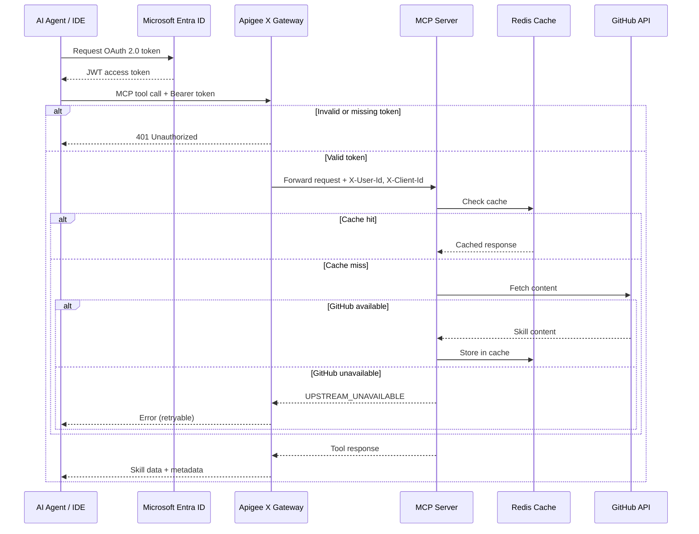
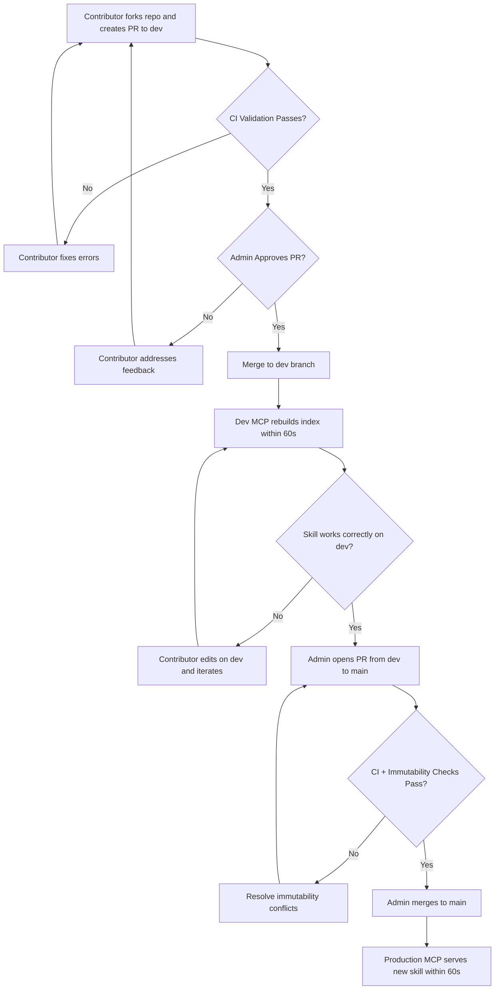
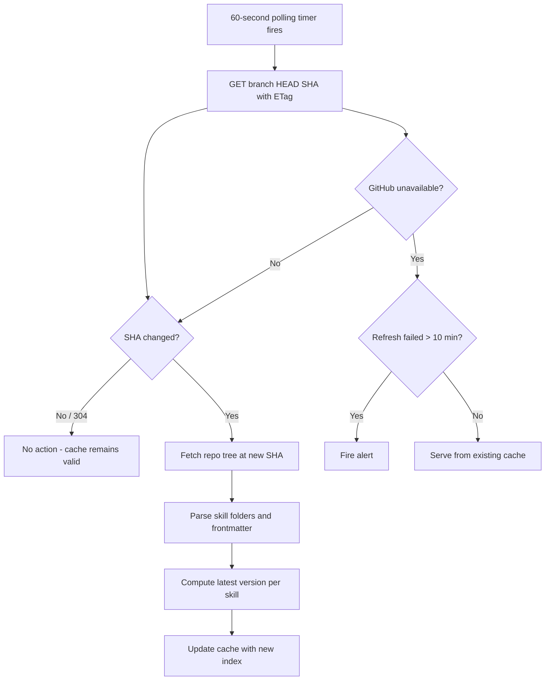
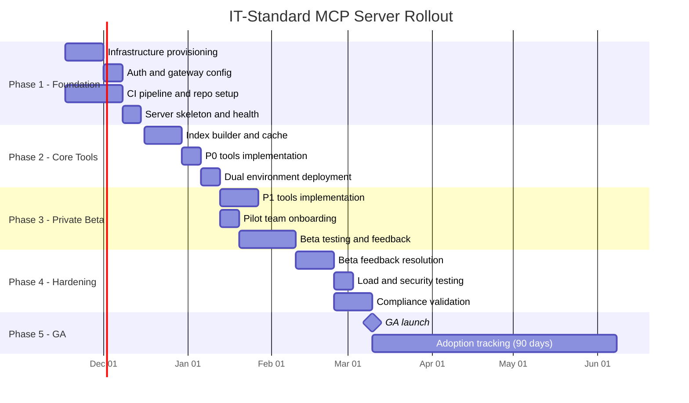

# PRD SPEC DRAFT

**Project:** SDLC-AI  
**Generated:** 2026-11-18T22:19:25.064Z

---

## Executive Summary

Intel's growing ecosystem of AI agents and IDE integrations demands a centralized, governed mechanism for distributing procedural knowledge — standardized instructions that teach agents how to perform specific tasks. Today, no unified channel exists for AI-assisted tools across the enterprise to discover, retrieve, and pin versioned skill definitions, forcing teams to duplicate effort, embed stale instructions, and operate without visibility into which skills are in use.

The IT-Standard MCP server addresses this gap by delivering a read-only Model Context Protocol (MCP) service that provides any MCP-compatible AI agent or IDE with instant, versioned access to a curated catalog of agent skills stored in a GitHub monorepo. The server exposes five purpose-built tools — catalog listing, keyword search, version browsing, exact-version retrieval, and latest-version retrieval — all secured behind OAuth 2.0 authentication enforced at an Apigee X API gateway with Microsoft Entra ID as the identity provider.

The primary beneficiaries are AI agent developers and the Intel employees who use those agents daily. By centralizing skill governance in an immutable, version-controlled repository with automated CI validation, the platform ensures every agent across the enterprise operates from the same trusted, up-to-date skill definitions. The initiative targets measurable adoption — a minimum of 40% of eligible AI agents and IDEs integrated within 90 days of general availability — while maintaining SOC 2 and GDPR compliance for all identity and usage data processed through the system.

---

## Business Objectives and Success Criteria

| Objective | How the Product Delivers | Success Criteria | Measurement Method |
|-----------|-------------------------|-----------------|--------------------|
| Establish a single source of truth for enterprise AI agent skills | A curated GitHub monorepo with immutable, semantically versioned skill definitions served through a read-only MCP interface, ensuring every agent retrieves the same canonical content | 100% of published skills are discoverable and retrievable through the MCP server within 60 seconds of merge to the production branch | Automated integration test suite validates end-to-end retrieval after each merge; observability logs confirm index refresh latency |
| Drive adoption of standardized skill consumption across AI agents and IDEs | Five MCP tools (catalog listing, search, version browsing, exact retrieval, latest retrieval) provide a frictionless, protocol-native integration path for any MCP-compatible client | ≥ 40% of eligible AI agents and IDEs integrated within 90 days of GA; ≥ 70% within 180 days | Structured observability logs track unique X-Client-Id values per rolling 30-day window; adoption dashboard reports percentage against known eligible client inventory |
| Ensure governance and compliance for skill lifecycle management | Fork-based contribution workflow with CI validation, admin-only merge authority via CODEOWNERS, branch protection, and immutability enforcement on the production branch | Zero unauthorized modifications to production skill versions; 100% of merged PRs pass CI validation including naming, format, frontmatter consistency, and secret scanning | CI pipeline pass/fail metrics; branch protection audit logs; quarterly compliance review |
| Maintain enterprise-grade reliability and performance | Stateless, horizontally scalable architecture on Intel CaaS with shared Redis cache, poll-based change detection, and graceful degradation when GitHub is unavailable | 99.5% monthly uptime for the MCP service; p95 tool response time ≤ 200 ms (cache hit) and ≤ 2 s (cache miss); zero data loss from cache serving stale content after upstream recovery | Health-check monitoring (/healthz, /readyz); structured log aggregation for latency percentiles; incident tracking for downtime events |
| Comply with SOC 2 and GDPR requirements for identity and usage data | Immutable audit logs for every tool invocation capturing actor identity, resource accessed, and timestamp; PII masked in logs; data retention policies enforced; access restricted to authenticated Intel employees via Entra ID | Audit log retention ≥ 1 year; zero PII exposure in log aggregation systems; annual SOC 2 audit passes without material findings related to the MCP service | Log retention policy enforcement checks; PII scanning of log pipelines; SOC 2 audit evidence collection |

---

## Personas and Stakeholders

| Name | Type | Role | Goals | Pain Points | How Served |
|------|------|------|-------|-------------|------------|
| MCP Client / AI Agent | Persona | Autonomous AI agent or IDE plugin that consumes skills to augment its capabilities | Discover relevant skills quickly; retrieve exact or latest versions reliably; pin a known-good version for deterministic behavior | No standardized discovery channel today; must hard-code skill content or fetch from ad-hoc sources; no version pinning or deprecation awareness | Five MCP tools provide protocol-native discovery, search, version browsing, and retrieval with commit-SHA pinning and deprecation warnings |
| Skill Contributor | Persona | Developer or standards author who creates or updates skill definitions | Publish new skills following clear conventions; receive fast CI feedback on formatting errors; test skills in a safe environment before production promotion | Unclear naming rules; no automated validation; risk of breaking production content during iteration | Strict folder/naming conventions documented; CI pipeline validates format, frontmatter, and immutability; dev environment (it-standard-dev) enables pre-production testing |
| Admin / Skill Publisher | Persona | Member of the it-standards-team who reviews and approves skill contributions | Maintain catalog quality and governance; ensure immutability of production versions; approve only well-formed, policy-compliant skills | Manual review burden; risk of accidental direct pushes; no automated enforcement of immutability rules | CODEOWNERS-based required review; branch protection prevents direct pushes; CI enforces immutability on main; admin-only merge authority |
| Consumer / End User | Persona | Authenticated Intel employee who benefits from agent-retrieved skills | Access all available skills without restrictions; trust that skills are current and governed | Unaware of available skills; no visibility into version history or deprecation status | All authenticated users see the full catalog; deprecation warnings surface in retrieval responses; version listing enables informed selection |
| Platform / DevOps Engineer | Persona | Operates the MCP server infrastructure, Apigee proxy, cache, and observability stack | Ensure high availability and low latency; scale horizontally without code changes; detect and resolve incidents quickly | Stateful services complicate scaling; lack of structured logs hinders troubleshooting; no health endpoints for orchestrator integration | Stateless container design on CaaS; /healthz and /readyz endpoints; structured JSON logs with correlation fields; alerting on index refresh failures, GitHub errors, and elevated error rates |
| IT Standards Program Owner | Stakeholder | Sponsors the skill catalog initiative and defines governance policies | Increase enterprise-wide adoption of standardized AI agent skills; demonstrate compliance and governance to auditors | Fragmented skill distribution; no usage analytics; difficulty proving governance controls to auditors | Adoption metrics from observability logs; immutable audit trail; SOC 2-aligned controls; usage analytics inform deprecation decisions |
| Information Security / Compliance Team | Stakeholder | Ensures the system meets Intel's security and regulatory obligations | Validate SOC 2 and GDPR compliance; confirm PII protection in logs; verify access controls | New systems introduce compliance risk; identity data in logs may violate GDPR if not masked | OAuth 2.0 via Entra ID with gateway-enforced authentication; PII masking in logs; data retention policies; secret scanning in CI |

---

## User Stories and Acceptance Criteria

| ID | As a... | I want to... | So that... | Priority | Acceptance Criteria |
|----|---------|-------------|-----------|----------|---------------------|
| US-001 | MCP Client / AI Agent | list all available skills in the catalog | I can present my user with a browsable catalog of capabilities I can learn | P0 | **Given** the MCP server has a cached skill index **When** I call `list_skills` **Then** I receive an array of all skill entries, each containing name, description, tags, latest version number, and status, served from cache when the branch HEAD SHA has not changed |
| US-002 | MCP Client / AI Agent | retrieve a specific skill by name and exact version | I can load a deterministic, pinned skill definition into my context | P0 | **Given** a valid skill name and version string in MAJOR.MINOR.PATCH format **When** I call `get_skill` with both parameters **Then** I receive the full SKILL.md content along with skill name, version, status, branch, commit_sha, and path; **Given** the version is deprecated **Then** the response includes a warning field (e.g., "SDLC 1.0.0 is deprecated; latest is 2.0.0") |
| US-003 | MCP Client / AI Agent | retrieve the latest version of a skill by name only | I always get the most current skill definition without tracking version numbers | P0 | **Given** a valid skill name **When** I call `get_latest_skill` **Then** I receive the content of the highest semantic version (numeric comparison, e.g., 1.10.0 > 1.9.0) with the resolved version number and commit_sha included so I can pin it later; **Given** the latest version is deprecated **Then** the warning field is populated |
| US-004 | MCP Client / AI Agent | search for skills by keyword | I can find relevant skills by topic without knowing exact names | P1 | **Given** a query string **When** I call `search_skills` **Then** matching is performed against skill name, description, and tags fields and I receive results with the same metadata as `list_skills`; **Given** an empty or non-matching query **Then** I receive an empty result set, not an error |
| US-005 | MCP Client / AI Agent | list all versions of a specific skill | I can browse version history and select the appropriate version to pin | P1 | **Given** a valid skill name **When** I call `list_versions` **Then** I receive all version folders with version number and status, ordered by semantic version (highest first); **Given** the skill does not exist **Then** I receive a SKILL_NOT_FOUND error with up to 5 similar skill names |
| US-006 | Skill Contributor | submit a new skill version via pull request and receive CI feedback | I know immediately whether my skill definition meets format and naming requirements | P0 | **Given** I open a PR to the dev branch with a new version folder **When** CI runs **Then** it validates: folder name matches `[a-zA-Z0-9-]+`, version folder matches `SKILL-MAJOR.MINOR.PATCH`, exactly one SKILL.md file exists, YAML frontmatter contains name/version/description/owner/status/tags, frontmatter name matches folder name, frontmatter version matches version folder; **Given** any validation fails **Then** CI reports the specific error and blocks merge |
| US-007 | Admin / Skill Publisher | review and merge skill contributions with confidence that governance rules are enforced | I can trust that production content remains immutable and policy-compliant | P0 | **Given** a PR targets the main branch **When** CI runs **Then** it rejects any modification or deletion of existing version folders; **Given** branch protection is configured **Then** merge requires PR approval from a CODEOWNERS-listed admin and passing CI; **Given** a PR passes all checks **Then** the admin can merge and the skill becomes available on the production MCP within ~60 seconds |
| US-008 | Platform / DevOps Engineer | monitor MCP server health and receive alerts on failures | I can detect and resolve incidents before they impact users | P1 | **Given** the MCP server is running **When** I query `/healthz` **Then** I receive a liveness status; **When** I query `/readyz` **Then** I receive ready status only after the first skill index is loaded; **Given** index refresh fails for more than 10 minutes **Then** an alert fires; **Given** the GitHub error rate exceeds threshold **Then** an alert fires |
| US-009 | MCP Client / AI Agent | receive a structured error when I request a non-existent skill | I can present a helpful message to my user instead of failing silently | P0 | **Given** I call `get_skill` with a skill name that does not exist **When** the server processes the request **Then** I receive a SKILL_NOT_FOUND error with up to 5 similar skill names; **Given** I provide an invalid version format (e.g., "v1", "2.00", "1.0") **Then** I receive an INVALID_VERSION error |
| US-010 | MCP Client / AI Agent | continue retrieving skills when GitHub is temporarily unavailable | my user experience is not disrupted by upstream outages | P0 | **Given** GitHub is unreachable **When** I call any retrieval tool for a previously cached skill **Then** I receive the cached content normally; **Given** I request a skill that has never been cached **Then** I receive an UPSTREAM_UNAVAILABLE error with `isRetryable: true` |
| US-011 | Consumer / End User | access skills through my AI agent without additional registration | I can benefit from the skill catalog immediately using my existing Intel credentials | P0 | **Given** I am an authenticated Intel employee **When** my AI agent calls the MCP server through Apigee **Then** my request is authorized using my existing Entra ID credentials with scope `api://it-standard-mcp/skills.read`; **Given** I am not authenticated **Then** I receive a 401 response with a WWW-Authenticate header pointing to the Entra ID authorization server |
| US-012 | Skill Contributor | test my skill on the dev MCP environment before promoting to production | I can verify my skill works correctly in a real MCP context without risking production content | P1 | **Given** my PR is merged to the dev branch **When** the dev MCP server polls for changes **Then** my new skill version is available at `/it-standard-dev/mcp` within ~60 seconds; **Given** I am satisfied with testing **Then** I open a PR from dev to main for production promotion |

---

## Business Process Overview

### Process 1: Skill Discovery and Retrieval by AI Agents

This is the primary value-delivery process. An MCP-compatible AI agent or IDE discovers, searches, and retrieves versioned skill definitions from the catalog to augment its capabilities during a user interaction.

**Trigger event:** An AI agent receives a user request that requires a skill it does not have embedded, or the agent proactively refreshes its skill inventory.

**Step-by-step flow:**

1. **Agent authenticates** — The agent's host application obtains an OAuth 2.0 access token from Microsoft Entra ID using a pre-registered app registration with scope `api://it-standard-mcp/skills.read`. *Input:* client credentials and user identity. *Output:* JWT access token.
2. **Agent calls MCP tool via Apigee** — The agent sends an MCP tool call (e.g., `list_skills`, `search_skills`, or `get_latest_skill`) to the Apigee X gateway endpoint. *Input:* MCP JSON-RPC request with Bearer token. *Output:* Apigee validates the JWT (issuer, audience, expiry, scope) and forwards the request with X-User-Id and X-Client-Id headers.
3. **Decision: Is the request authenticated?** — If the JWT is invalid or missing, Apigee returns a 401 error with a WWW-Authenticate header. The agent must re-authenticate. *Error path:* Agent retries with a fresh token or surfaces an authentication error to the user.
4. **MCP server processes the tool call** — The server checks its cache for the requested data. *Decision: Cache hit or miss?* On a cache hit, the server returns the cached response immediately. On a cache miss, the server fetches content from the GitHub API.
5. **Decision: Is GitHub available?** — If GitHub is unreachable and the content was previously cached, the server serves stale cache. If the content was never cached, the server returns an UPSTREAM_UNAVAILABLE error (retryable). *Error path:* Agent may retry after a delay or inform the user of temporary unavailability.
6. **Agent receives skill content** — The agent incorporates the skill definition into its context and proceeds with the user's task. *Output:* Skill content with metadata (name, version, status, commit SHA, deprecation warnings if applicable).

**Participants:** AI Agent, Apigee X Gateway, MCP Server, Redis Cache, GitHub API, Microsoft Entra ID.

**Business outcome:** The agent is equipped with a governed, versioned skill definition and can perform the user's requested task with standardized instructions.

---

### Process 2: Skill Publishing and Promotion Workflow

This process governs how new or updated skill definitions move from authoring through validation, testing, and production publication. It ensures governance, quality, and immutability of production content.

**Trigger event:** A Skill Contributor creates or updates a SKILL.md file and opens a pull request to the dev branch.

**Step-by-step flow:**

1. **Contributor forks and creates PR** — The contributor forks the monorepo, creates a version folder following the `SKILL-MAJOR.MINOR.PATCH` convention with a SKILL.md file, and opens a PR to the dev branch. *Input:* New version folder with SKILL.md containing YAML frontmatter. *Output:* PR created in GitHub.
2. **CI validation runs** — Automated checks validate naming conventions, folder structure, SKILL.md format, YAML frontmatter consistency (name matches folder, version matches subfolder), and run secret scanning. *Decision: Do all checks pass?* If any check fails, CI reports the specific error and blocks merge. *Error path:* Contributor fixes the issues and pushes updated commits.
3. **Admin review** — A CODEOWNERS-listed admin reviews the PR for content quality and policy compliance. *Decision: Does the admin approve?* If rejected, the contributor receives feedback and iterates. *Error path:* PR remains open until issues are resolved or is closed.
4. **Merge to dev** — The admin merges the approved PR to the dev branch. *Input:* Approved PR. *Output:* Skill version available on dev branch.
5. **Testing on dev MCP** — Within ~60 seconds, the dev MCP server (it-standard-dev) detects the new commit SHA via polling and rebuilds its index. The contributor and admin verify the skill is correctly served. *Decision: Does the skill work correctly?* If issues are found, the contributor can edit the version folder on dev (dev is mutable) and iterate.
6. **Promotion PR to main** — Once testing passes, the admin opens a PR from dev to main. CI re-validates and additionally enforces immutability — no existing version folders on main may be modified or deleted. *Decision: Do immutability checks pass?* If the PR attempts to modify an existing production version, CI rejects it.
7. **Merge to main** — The admin merges to main. The production MCP server (it-standard) detects the change within ~60 seconds and serves the new skill. *Output:* Skill version is live in production, immutable, and available to all agents enterprise-wide.

**Participants:** Skill Contributor, CI Pipeline, Admin/Skill Publisher, Dev MCP Server, Production MCP Server.

**Business outcome:** A new skill version is published to production with full governance — validated format, admin approval, pre-production testing, and immutability guarantees.

---

### Process 3: Cache Refresh and Change Detection

This background process ensures the MCP server's skill index stays synchronized with the GitHub monorepo without relying on webhooks, using a polling-based approach that minimizes API consumption.

**Trigger event:** A 60-second polling timer fires on the MCP server.

**Step-by-step flow:**

1. **Poll branch HEAD SHA** — The server sends a conditional GET request to the GitHub API for the configured branch's HEAD commit SHA, including the ETag from the previous response. *Input:* Branch name, previous ETag. *Output:* Current SHA or 304 Not Modified.
2. **Decision: Has the SHA changed?** — If GitHub returns 304 Not Modified, no action is taken; the existing cache remains valid and no rate-limit quota is consumed. If a new SHA is returned, the server proceeds to rebuild.
3. **Rebuild skill index** — The server fetches the full repository tree at the new SHA, parses skill folders and version subfolders, extracts YAML frontmatter from each SKILL.md, and computes the latest version per skill using numeric semantic version comparison. *Input:* Repository tree at new SHA. *Output:* Updated skill index.
4. **Update cache** — The new index is stored with key `index:<branch>:<sha>`. Individual skill content on main is cached indefinitely (immutable). Skill content on dev is cached with SHA-scoped keys and invalidated when the SHA changes. *Output:* Cache updated.
5. **Decision: Is GitHub unavailable?** — If the poll request fails, the server continues serving from the existing cache. An alert fires if refresh fails for more than 10 consecutive minutes. *Error path:* Stale cache is served; UPSTREAM_UNAVAILABLE is returned only for items never previously cached.

**Participants:** MCP Server (polling timer), GitHub API, Redis Cache.

**Business outcome:** The skill catalog stays current within one polling interval (~60 seconds) while minimizing GitHub API consumption through conditional requests and leveraging content immutability on the production branch.

---

## Business Rules and Policies

| Rule | When It Applies | User Experience | Example |
|------|----------------|-----------------|--------|
| **Skill folder naming** — Skill folder names must contain only letters (a-z, A-Z), digits (0-9), and hyphens. No spaces, underscores, or special characters are permitted. | When a contributor creates a new skill folder in the monorepo | CI rejects the PR with a specific error message identifying the invalid characters in the folder name | A folder named `my_skill` or `My Skill` is rejected; `my-skill` or `MySkill` is accepted |
| **Version folder format** — Each version subfolder must follow the pattern `SKILL-MAJOR.MINOR.PATCH` where MAJOR, MINOR, and PATCH are non-negative integers without leading zeros. | When a contributor creates a new version folder | CI rejects malformed version folders with a message showing the expected pattern | `SKILL-2.00` (leading zero), `SKILL-v1` (prefix), `skill-1.0.0` (lowercase prefix), and `SKILL-1.0` (missing patch) are all rejected; `SKILL-1.0.0` and `SKILL-10.2.3` are accepted |
| **Single-file skill constraint** — Each version folder must contain exactly one file named `SKILL.md`. No additional files are permitted. | When a contributor adds files to a version folder | CI rejects PRs that include extra files (scripts, templates, images) in version folders | A version folder containing both `SKILL.md` and `helper.py` is rejected |
| **Frontmatter consistency** — The YAML frontmatter in SKILL.md must include name, version, description, owner, status, and tags. The `name` field must match the skill folder name and the `version` field must match the version folder. | When CI validates a SKILL.md file | CI rejects the PR with a specific error if any required field is missing or if name/version values do not match their containing folders | A SKILL.md in folder `SDLC/SKILL-2.0.0` with frontmatter `name: sdlc` (case mismatch) or `version: 1.0.0` (version mismatch) is rejected |
| **Production immutability** — Version folders on the main branch are immutable once merged. No modifications or deletions of existing version folders are permitted. Any correction requires publishing a new version. | When a PR targets the main branch and modifies or deletes an existing version folder | CI rejects the PR with an immutability violation error identifying the affected version folder | A PR that edits `SDLC/SKILL-1.0.0/SKILL.md` on main is rejected; the contributor must create `SDLC/SKILL-1.0.1/SKILL.md` instead |
| **Dev branch mutability** — Version folders on the dev branch are editable while being tested, allowing iteration before promotion to production. | When a contributor modifies an existing version folder on the dev branch | The modification is permitted; CI validates format and naming but does not enforce immutability on dev | A contributor can update `SDLC/SKILL-2.0.0/SKILL.md` on dev to fix a typo before promoting to main |
| **Secret scanning** — All skill content is scanned for secrets (API keys, tokens, credentials) on every PR to both dev and main branches. | When any PR is opened or updated | CI rejects the PR if potential secrets are detected, with a message identifying the suspicious content | A SKILL.md containing a string matching an API key pattern (e.g., `AKIA...`) triggers a CI failure |
| **Authentication required** — All requests to the MCP server must be authenticated via OAuth 2.0 with a valid JWT issued by Microsoft Entra ID. Unauthenticated requests are rejected at the gateway. | When any client sends a request to the MCP endpoint | Unauthenticated requests receive a 401 response with a WWW-Authenticate header pointing to the Entra ID authorization server and required scope | An agent that sends a request without a Bearer token receives `401 Unauthorized` with metadata to initiate the OAuth flow |
| **Universal read access** — All authenticated Intel employees can read all skills. There are no per-group or per-role restrictions on skill content access. | When an authenticated user's request reaches the MCP server | Every authenticated user sees the complete skill catalog; no skills are hidden or restricted | A new Intel employee's AI agent can immediately discover and retrieve all published skills after authenticating |
| **Semantic version resolution** — "Latest" version is always computed as the highest semantic version using numeric comparison, not lexicographic sorting. | When `list_skills` computes the latest version or `get_latest_skill` resolves a version | Version 1.10.0 is correctly identified as newer than 1.9.0 (numeric comparison), unlike lexicographic sorting which would rank 1.9.0 higher | For a skill with versions 1.2.0, 1.9.0, and 1.10.0, the latest is 1.10.0 |
| **Deprecation transparency** — Deprecated skill versions remain accessible and are included in listings with their status clearly marked. Retrieval of deprecated versions includes a warning message. | When a user retrieves or lists a deprecated skill version | The skill content is returned normally, but a warning field indicates the deprecation and suggests the latest version | Retrieving `SDLC` version `1.0.0` (deprecated) returns the content plus `warning: "SDLC 1.0.0 is deprecated; latest is 2.0.0"` |
| **Audit logging for compliance** — Every tool invocation must produce an immutable audit record containing actor identity, resource accessed, timestamp, and operational details. Logs must be retained for at least one year. | When any MCP tool is called | No visible impact to the user; logging occurs transparently. Logs support SOC 2 audit evidence and usage analytics. | A `get_skill` call generates a log entry with timestamp, tool name, skill, version, X-User-Id, X-Client-Id, environment, branch, commit SHA, cache hit/miss, latency, and result |
| **PII protection in logs** — User identity information forwarded from the gateway (X-User-Id) must be treated as internal-confidential data. PII must be masked or pseudonymized in any log exports to non-production environments. | When logs are aggregated, exported, or accessed outside the production logging system | No impact to the user; PII protection is enforced at the infrastructure level | X-User-Id values are hashed or masked before logs are replicated to development or analytics environments |
| **Data retention** — Audit logs are retained for a minimum of 1 year. Cached skill content follows the immutability model (main branch content cached indefinitely; dev branch content invalidated on SHA change). | When retention policies are enforced by the logging and caching infrastructure | No direct user impact; ensures compliance with SOC 2 audit requirements | Audit logs from November 2026 remain queryable through November 2027 |

---

## Success Metrics and KPIs

### Primary Metrics

| Metric | Target | Measurement Method | Timeline | Business Impact |
|--------|--------|--------------------|----------|----------------|
| Skill discovery/retrieval adoption rate | ≥ 40% of eligible AI agents/IDEs integrated within 90 days of GA; ≥ 70% within 180 days | Count unique X-Client-Id values in structured logs per rolling 30-day window; compare against known eligible client inventory | 90 / 180 days post-GA | Validates that the platform delivers value and justifies continued investment |
| Skill catalog coverage | ≥ 50 published skills within 90 days of GA | Count distinct skill folders on the main branch | 90 days post-GA | Ensures sufficient content to drive agent adoption |
| Skill retrieval success rate | ≥ 99% of tool calls return a successful response (non-error) | Ratio of successful responses to total tool calls from structured logs | Ongoing from GA | Confirms reliability of the core value proposition |

### Secondary Metrics

| Metric | Target | Measurement Method | Timeline | Business Impact |
|--------|--------|--------------------|----------|----------------|
| Mean time from merge-to-dev to production availability | ≤ 4 hours (governance workflow) | Timestamp difference between dev merge and main merge from Git history | Ongoing from GA | Measures publishing workflow efficiency |
| Contributor onboarding success rate | ≥ 80% of first-time PRs pass CI on the second attempt or fewer | CI pass/fail logs correlated with contributor history | 180 days post-GA | Validates that naming/format conventions are learnable |
| Unique skills retrieved per agent per month | ≥ 5 distinct skills per active agent | Structured logs grouped by X-Client-Id and skill name | Monthly from GA | Indicates breadth of skill utilization beyond single-skill integrations |

### Guardrail Metrics

| Metric | Target | Measurement Method | Timeline | Business Impact |
|--------|--------|--------------------|----------|----------------|
| MCP service uptime | ≥ 99.5% monthly | Health-check monitoring (/healthz, /readyz); incident tracking | Monthly from beta | Ensures agents can rely on the service for production workloads |
| p95 tool response time (cache hit) | ≤ 200 ms | Latency percentiles from structured logs | Ongoing from beta | Prevents the MCP server from becoming a bottleneck in agent response times |
| p95 tool response time (cache miss) | ≤ 2,000 ms | Latency percentiles from structured logs | Ongoing from beta | Ensures acceptable performance even during index rebuilds |
| Error rate (5xx responses) | < 0.5% of total requests | Apigee analytics and structured logs | Ongoing from beta | Detects systemic failures before they impact adoption |
| GitHub API rate-limit utilization | < 50% of allocated quota | GitHub API rate-limit headers logged per polling cycle | Ongoing from beta | Prevents rate-limit exhaustion that would block index refreshes |
| Unauthorized access attempts | 0 successful bypasses of Apigee gateway | Security audit logs; penetration testing results | Quarterly | Confirms the security boundary is intact |

---

## Risks Assumptions Dependencies and Constraints

### Risks

| Risk | Probability | Business Impact | Trigger Conditions | Mitigation | Owner |
|------|------------|-----------------|-------------------|------------|-------|
| GitHub API rate-limit exhaustion blocks index refresh | Medium | Skill index becomes stale; new or updated skills are not served; agents operate on outdated content | High polling frequency across multiple replicas; large repository tree requiring many API calls per refresh; GitHub App token rate limits reduced | Use conditional GET with ETag (304 responses do not count against quota); share cache across replicas via Redis to avoid redundant polling; monitor rate-limit utilization and alert at 50% threshold | Platform / DevOps Engineer |
| Low initial adoption by AI agent teams | Medium | Investment in the platform does not deliver expected ROI; skill catalog lacks feedback loop for improvement | Agent teams are unaware of the service; integration effort perceived as too high; insufficient skill content at launch | Private beta with pilot teams to build advocacy; provide integration guides and sample code; target ≥ 50 skills at launch to demonstrate value; track adoption KPI weekly | IT Standards Program Owner |
| GitHub monorepo unavailability during extended outage | Low | MCP server cannot refresh its index; new skills are not served; UPSTREAM_UNAVAILABLE errors for uncached items | GitHub infrastructure outage lasting > 10 minutes; network connectivity issues between CaaS and GitHub | Graceful degradation — serve from cache during outages; alert after 10 minutes of refresh failure; main branch content cached indefinitely reduces blast radius | Platform / DevOps Engineer |
| Apigee X misconfiguration exposes MCP server directly | Low | Unauthenticated access to the MCP server; potential data exposure; SOC 2 compliance violation | CaaS ingress not properly restricted to Apigee egress addresses; mTLS or shared secret header not enforced | Restrict CaaS ingress to Apigee egress IPs; enforce mTLS or shared secret header validation; penetration testing during beta; quarterly security review | Information Security Team |
| GDPR non-compliance in log handling | Medium | Regulatory fines; reputational damage; audit findings | X-User-Id (PII) stored in logs without masking; logs exported to non-production environments without anonymization; retention exceeds necessity | Mask or pseudonymize PII in log exports; enforce 1-year retention with automated purge; document data processing in GDPR records of processing activities | Information Security / Compliance Team |
| Skill content quality degrades without sufficient governance | Medium | Agents consume poorly written or outdated skills; user trust in the platform erodes | Insufficient admin review rigor; no content quality standards beyond format validation; deprecated skills not clearly communicated | CI enforces format and naming; admin review required for all merges; deprecation status visible in all tool responses; usage analytics inform deprecation decisions | Admin / Skill Publisher |

### Assumptions

| Assumption | Impact if Wrong | Validation Plan |
|-----------|----------------|----------------|
| [ASSUMPTION] The GitHub monorepo in the intel-innersource organization will be available and accessible via GitHub App credentials with read-only contents permission | The MCP server cannot fetch skill content; the entire service is non-functional | Validate GitHub App registration and permissions during development; test connectivity from CaaS environment during beta |
| [ASSUMPTION] Intel CaaS platform supports stateless container deployments with Redis (or equivalent) as a shared cache service | Architecture must be redesigned if shared cache is unavailable; polling coordination across replicas becomes complex | Confirm CaaS service catalog includes Redis or equivalent; validate connectivity and latency during infrastructure setup |
| [ASSUMPTION] Apigee X can be configured to validate Entra ID JWTs, forward custom headers, and support streaming HTTP responses with adequate timeouts | Authentication and transport architecture must be redesigned if Apigee lacks these capabilities | Prototype Apigee proxy configuration during development; validate JWT validation, header forwarding, and streaming support |
| [ASSUMPTION] The MCP SDK (TypeScript or Python) supports Streamable HTTP transport for server implementations | Transport layer must be custom-built if SDK does not support Streamable HTTP | Evaluate SDK capabilities during technology selection; prototype transport layer early |
| [ASSUMPTION] The initial skill catalog will contain ≥ 50 skills at GA to drive meaningful adoption | Low content volume reduces adoption incentive; agents find limited value in integrating | Coordinate with skill contributors during beta to seed the catalog; track skill publication rate weekly |
| [ASSUMPTION] All eligible AI agents and IDEs at Intel support the Model Context Protocol | Agents that do not support MCP cannot integrate; adoption ceiling is lower than estimated | Survey agent teams during beta to assess MCP compatibility; provide integration guidance for common agent frameworks |

### Dependencies

| System/Team | Dependency | Timeline | Impact if Delayed |
|------------|-----------|----------|------------------|
| Microsoft Entra ID | App registration with scope `api://it-standard-mcp/skills.read`; JWKS endpoint availability for JWT validation | Required before beta launch | Authentication cannot be configured; no client can access the service |
| Apigee X Platform Team | Proxy configuration for JWT validation, header forwarding, streaming support, and dual-path routing (/it-standard/mcp, /it-standard-dev/mcp) | Required before beta launch | MCP server is not reachable through the gateway; authentication is not enforced |
| Intel CaaS Platform | Container hosting with private/restricted ingress, secrets management, and Redis (or equivalent) cache service | Required before beta launch | No deployment target; architecture cannot be validated |
| GitHub (intel-innersource) | Monorepo creation, GitHub App registration, branch protection configuration, CODEOWNERS file | Required before development starts | No content source; CI pipeline cannot be built |
| IT Standards Team | Seed skill content (≥ 50 skills); CODEOWNERS membership; admin availability for PR reviews | Required before GA | Insufficient content for meaningful adoption; publishing workflow is blocked |
| Pilot Agent Teams | 3-5 teams willing to integrate during private beta and provide feedback | Required before GA sign-off | No validation of real-world usage patterns; adoption risk increases |

### Constraints

| Constraint | Type | Impact |
|-----------|------|--------|
| Read-only server — no write operations to GitHub or any other system | Technical | Simplifies security model but means all content management happens through Git workflows, not through the MCP server |
| Stateless server design — no session state | Technical | Enables horizontal scaling but requires shared cache (Redis) for cross-replica consistency |
| Polling-based change detection only — no webhooks | Technical | Introduces up to 60-second latency for new content visibility; simplifies infrastructure by avoiding webhook endpoint management |
| Single-file skills only (one SKILL.md per version folder) | Technical | Limits skill complexity; multi-file skills (scripts, templates) are deferred to a future phase |
| SOC 2 + GDPR compliance required | Regulatory | Mandates audit logging, PII protection, data retention policies, and access controls; increases development and operational overhead |
| No Dynamic Client Registration | Business | Every consuming agent/IDE must use a pre-registered Entra app registration; onboarding requires documentation, not self-service |
| Private beta before GA | Business | Delays broad availability but reduces risk of launching with insufficient content or undiscovered issues |

---

## Scope NFRs and Open Questions

### In Scope

- Read-only MCP server exposing five tools: catalog listing, keyword search, version browsing, exact-version retrieval, and latest-version retrieval
- Versioned skill storage in a GitHub monorepo with strict folder naming and semantic versioning conventions
- SKILL.md format with YAML frontmatter (name, version, description, owner, status, tags)
- OAuth 2.0 authentication via Microsoft Entra ID with JWT validation at the Apigee X gateway
- Poll-based cache invalidation using branch HEAD SHA with 60-second polling interval
- Dual environment deployment: production (main branch) and dev (dev branch) from the same container image
- CI validation pipeline for pull requests: naming, format, frontmatter consistency, immutability enforcement, and secret scanning
- Fork-based publishing workflow with admin review, branch protection, and CODEOWNERS enforcement
- Health endpoints for container orchestration (/healthz, /readyz)
- Structured observability logging with correlation fields for every tool invocation
- Typed error responses (SKILL_NOT_FOUND, VERSION_NOT_FOUND, INVALID_VERSION, UPSTREAM_UNAVAILABLE)
- Deprecation support with warning messages in retrieval responses
- Graceful degradation when GitHub is unavailable (serve from cache)

### Out of Scope

- Integration with the Intel AI Asset Catalog (deferred to a future phase)
- GitHub webhook-based change detection
- Client-credentials flows that trigger write processes — agents only read
- Per-group or per-role access restrictions on skill content
- Multi-file skills (scripts, templates, images within a version folder)
- Write operations to GitHub or any other system through the MCP server
- OAuth Dynamic Client Registration
- Web or mobile UI for skill browsing — access is exclusively through MCP tools
- Skill authoring, editing, or content management through the MCP server

### Future Consideration

- Intel AI Asset Catalog integration for broader asset discovery
- Multi-file skill support (scripts, templates, configuration files alongside SKILL.md)
- Webhook-based change detection for sub-second content freshness
- Self-service client registration for agent onboarding
- Skill usage analytics dashboard for program owners
- Skill recommendation engine based on agent context and usage patterns
- Content quality scoring and automated deprecation workflows

### Non-Functional Requirements

**Performance:**
- p95 tool response time ≤ 200 ms for cache-hit requests
- p95 tool response time ≤ 2,000 ms for cache-miss requests (including GitHub API fetch)
- Index rebuild completes within 10 seconds for a catalog of up to 500 skills with 5 versions each
- Polling overhead: ≤ 1 GitHub API call per 60 seconds per replica when content is unchanged (304 response)

**Security:**
- All requests authenticated via OAuth 2.0 JWT validated at Apigee X gateway; MCP server trusts gateway-forwarded identity headers
- CaaS ingress restricted to Apigee egress addresses; Apigee-to-MCP traffic secured via mTLS or shared secret header
- No secrets, tokens, or credentials stored in container images; all credentials managed through CaaS secrets
- Input validation on all tool parameters: skill names validated against allow-list pattern `[a-zA-Z0-9-]+`; version strings validated against `^\d+\.\d+\.\d+$`; query strings length-limited and sanitized
- Secret scanning on all skill content during CI

**Accessibility:**
- WCAG 2.1 AA compliance is not directly applicable as the system has no user-facing UI. The MCP tools return structured data consumed programmatically by agents and IDEs. Accessibility requirements apply to any future UI built on top of this service. [ASSUMPTION]

**Scalability:**
- Stateless server design supports horizontal scaling on CaaS with no code changes
- Shared Redis cache enables consistent responses across replicas
- Target capacity: support up to 100 concurrent MCP clients with sustained throughput of 500 tool calls per minute [ASSUMPTION]
- Catalog size: support up to 500 skills with up to 20 versions each (10,000 version folders)

**Compliance:**
- SOC 2 Type II: immutable audit logs for all tool invocations and authentication events; access controls enforced at gateway; annual audit evidence collection
- GDPR: PII (X-User-Id) masked in log exports to non-production environments; data retention policy enforced (audit logs ≥ 1 year, cached content per immutability model); data processing documented in records of processing activities
- All data classified per organizational policy: skill content = Internal; user identity headers = Confidential; audit logs = Internal; cached indexes = Internal

**Internationalization:**
- Multi-language support is not required for the initial release. Skill content is authored in English. The MCP server does not perform locale-aware formatting. [ASSUMPTION]

### Open Questions

| # | Question | Context | Who Needs to Answer |
|---|----------|---------|--------------------|
| 1 | What is the primary programming language and MCP SDK for the server implementation (TypeScript with @modelcontextprotocol/sdk or Python with FastMCP)? | Both are viable per research; TypeScript SDK v2 requires Node.js 20+ with Zod validation; Python FastMCP uses Pydantic. Decision affects build toolchain, testing framework, and team skill requirements. | Engineering Lead |
| 2 | What specific search algorithm should `search_skills` use — substring matching, fuzzy matching (e.g., Levenshtein distance), or weighted field matching (name > tags > description)? | The intent specifies matching against name, description, and tags but does not define the algorithm. Choice affects relevance quality and implementation complexity. | Product Owner + Engineering Lead |
| 3 | What are the specific Apigee rate-limiting quotas per client (requests per minute, burst limits)? | Rate limits protect the service but must be set high enough to not impede legitimate agent usage patterns. | Apigee Platform Team |
| 4 | What is the expected scale at launch — number of skills, number of concurrent agent clients, and peak request volume? | Affects cache sizing, Redis configuration, and CaaS resource allocation. Current assumptions are 500 skills and 100 concurrent clients. | IT Standards Program Owner + Platform Team |
| 5 | What testing strategy and frameworks will be used (unit tests, integration tests, MCP contract tests, load tests)? | No testing approach is specified in the intent. Critical for quality assurance of the five MCP tools and cache behavior. | Engineering Lead |
| 6 | How will the "similar skill names" suggestion work for SKILL_NOT_FOUND errors (up to 5 suggestions)? What similarity algorithm (edit distance, prefix matching) should be used? | The intent specifies "up to 5 similar names" but does not define the matching approach. | Engineering Lead |
| 7 | What is the process for deprecating a skill version — who sets the status to "deprecated" and through what mechanism (frontmatter update + new PR)? | Deprecation is referenced in tool responses but the governance process for marking a version as deprecated is not fully specified. | IT Standards Program Owner |

---

## Rollout Plan

### Phase 1: Foundation and Infrastructure (Weeks 1–4)
**Timeline:** 2026-11-17 to 2026-12-15

**Description:** Establish the technical foundation — provision infrastructure, configure authentication and gateway, set up the GitHub monorepo with branch protection and CI pipeline, and implement the core MCP server skeleton with health endpoints.

**Key Milestones and Deliverables:**
- CaaS environment provisioned with Redis cache and secrets management
- Apigee X proxy configured with Entra ID JWT validation, header forwarding, and dual-path routing
- GitHub monorepo created with CODEOWNERS, branch protection on main and dev, and CI validation pipeline (naming, format, frontmatter, immutability, secret scanning)
- MCP server skeleton deployed with Streamable HTTP transport, /healthz and /readyz endpoints
- Entra ID app registration created with scope `api://it-standard-mcp/skills.read`

**Dependencies:** CaaS Platform Team, Apigee Platform Team, GitHub admin access, Entra ID admin access

**Success Gate:** Health endpoints respond correctly; Apigee validates test JWTs and forwards headers; CI pipeline rejects invalid skill PRs and accepts valid ones; end-to-end connectivity verified from Apigee through CaaS to GitHub API.

**Owner:** Platform / DevOps Engineering Team

---

### Phase 2: Core Tool Implementation (Weeks 5–8)
**Timeline:** 2026-12-16 to 2027-01-12

**Description:** Implement the three P0 MCP tools (list_skills, get_skill, get_latest_skill) plus the caching layer with poll-based change detection. Deploy to both environments (it-standard and it-standard-dev).

**Key Milestones and Deliverables:**
- Skill index builder: parses repo tree, extracts frontmatter, computes latest version per skill via numeric semver comparison
- Cache manager: index cache with `index:<branch>:<sha>` keys; content cache with immutable main keys and SHA-scoped dev keys; 60-second polling with ETag
- `list_skills` tool: returns all skills with name, description, tags, latest version, status
- `get_skill` tool: retrieves exact version with full error taxonomy (SKILL_NOT_FOUND, VERSION_NOT_FOUND, INVALID_VERSION, UPSTREAM_UNAVAILABLE)
- `get_latest_skill` tool: resolves highest semver with deprecation warnings
- Structured observability logging for all tool calls
- Dual environment deployment validated (it-standard on main, it-standard-dev on dev)

**Dependencies:** Phase 1 infrastructure complete; ≥ 10 seed skills published to dev branch for testing

**Success Gate:** All three P0 tools pass integration tests; cache hit/miss behavior verified; graceful degradation confirmed when GitHub is simulated as unavailable; structured logs contain all required fields; dev and production environments serve content from their respective branches.

**Owner:** Engineering Team

---

### Phase 3: Private Beta (Weeks 9–12)
**Timeline:** 2027-01-13 to 2027-02-09

**Description:** Onboard 3–5 pilot agent teams for real-world validation. Implement P1 tools (search_skills, list_versions). Collect feedback on tool contracts, error handling, and performance. Seed the catalog to ≥ 50 skills.

**Key Milestones and Deliverables:**
- `search_skills` tool: keyword matching against name, description, and tags
- `list_versions` tool: all versions ordered by semver with SKILL_NOT_FOUND handling
- Pilot team onboarding: integration guides, sample code, Entra app registration documentation
- ≥ 50 skills published to main branch
- Beta feedback collected: tool usability, error message clarity, response time satisfaction, missing capabilities
- Alerting configured: index refresh failure > 10 min, GitHub error rate threshold, elevated 5xx rate

**Dependencies:** Phase 2 tools deployed; pilot teams identified and committed; IT Standards Team seeds ≥ 50 skills

**Success Gate:** ≥ 3 pilot teams successfully integrated and actively retrieving skills; p95 response time ≤ 200 ms (cache hit); zero security incidents; no critical bugs open; pilot team satisfaction survey ≥ 4/5.

**Owner:** Product Owner + Engineering Team

---

### Phase 4: Hardening and GA Readiness (Weeks 13–16)
**Timeline:** 2027-02-10 to 2027-03-09

**Description:** Address beta feedback, complete SOC 2 and GDPR compliance validation, finalize observability and alerting, conduct load testing, and prepare for general availability.

**Key Milestones and Deliverables:**
- Beta feedback items resolved
- Load testing: validate 100 concurrent clients at 500 tool calls/minute
- SOC 2 evidence package: audit logs, access controls, change management documentation
- GDPR validation: PII masking in log exports confirmed; data retention policies enforced; records of processing activities documented
- Penetration testing: validate Apigee gateway enforcement, CaaS ingress restrictions, mTLS/shared secret
- Operational runbook: incident response procedures, cache recovery, GitHub outage handling
- GA launch communications prepared

**Dependencies:** Phase 3 beta feedback collected; Security team available for penetration testing; Compliance team available for SOC 2 review

**Success Gate:** Load test passes at target capacity; penetration test reveals no critical or high findings; SOC 2 evidence package accepted by compliance team; PII masking validated; operational runbook reviewed and approved.

**Owner:** Engineering Team + Information Security / Compliance Team

---

### Phase 5: General Availability (Week 17+)
**Timeline:** 2027-03-10 onward

**Description:** Open the MCP server to all Intel AI agent teams and IDE integrations. Begin tracking adoption KPIs against targets. Establish ongoing governance and operational cadence.

**Key Milestones and Deliverables:**
- GA announcement to all eligible agent teams with onboarding documentation
- Adoption tracking dashboard operational (unique X-Client-Id count vs. eligible inventory)
- Weekly adoption reporting for first 90 days
- Monthly operational review: uptime, latency, error rates, GitHub API utilization
- Quarterly compliance review cycle established

**Dependencies:** Phase 4 sign-off gate passed

**Success Gate:** ≥ 40% of eligible AI agents/IDEs integrated within 90 days of GA; 99.5% monthly uptime maintained; zero SOC 2 material findings.

**Owner:** IT Standards Program Owner + Platform / DevOps Engineering Team

---

## Confidence

Overall: **100%**

| Section | Score | Why | How to Improve |
|---------|-------|-----|----------------|
| Intent Alignment | 100% | All 12 intent features covered. | Intent is well-captured. Consider adding comments for priority rankings or phasing details. |
| Policy Compliance | 100% | All 24 policies addressed. | Good policy alignment. Verify any industry-specific regulations are covered. |
| Context Documents | N/A | Not provided — no documents uploaded for this dimension. | Upload the relevant documents to enable this check. |
| Structural Completeness | 100% | All 10 required sections present. | All expected sections are present. Add comments on any section if you want more depth. |
| Evidence Traceability | 100% | 100% of provenance references include specific evidence (file paths, section names, quotes). | Include specific file paths, section references, or direct quotes in provenance citations. |
| User Refinements | 97% | All four user gap-answer decisions incorporated as immutable constraints: (1) SOC 2 + GDPR reflected in objectives, business rules, RADC, and NFRs; (2) Adoption rate KPI (≥40% within 90 days) specified in objectives, success metrics, and rollout success gates; (3) P0 scope = retrieval + catalog listing reflected in user story priorities and rollout phasing; (4) Private beta with sign-off gate reflected in rollout plan Phases 3-4. Minor gap: the exact percentage threshold for the adoption KPI was inferred as 40% based on the user's guidance of '% of eligible AI agents/IDEs integrated within 90… | Add comments on specific sections to guide the next regeneration. |

> Strongly aligned with project intent and provided context.
